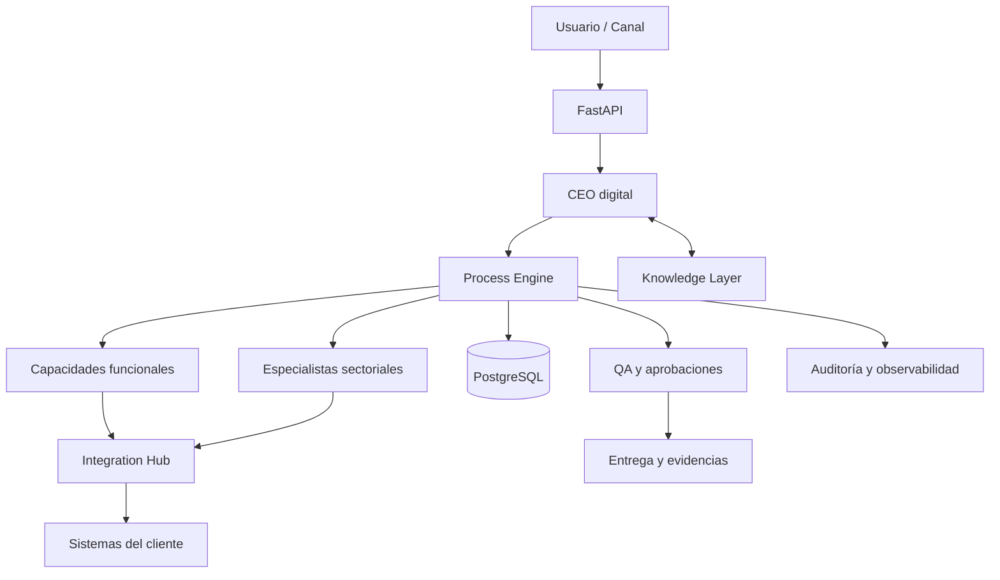

# Arquitectura general

## Vista lógica
Usuario/canal → API → CEO digital → Process Engine → capacidades funcionales y especialistas → Integration Hub → sistemas del cliente. Knowledge Layer, identidad, permisos, auditoría, evaluación y observabilidad son transversales.

## Componentes
1. Canales web/móvil y canales empresariales.
2. Backend Python + FastAPI.
3. CEO/orquestador para clasificar, aclarar, planificar y enrutar.
4. Process Engine para estados, tareas, dependencias, reintentos y aprobaciones.
5. Capacidades funcionales y perfiles sectoriales.
6. Knowledge Layer con documentos fuente, Wiki, búsqueda y permisos.
7. Integration Hub para conectores.
8. PostgreSQL como fuente operativa y almacenamiento de objetos para documentos.
9. Control plane de identidad, auditoría, calidad, costes y configuración.

## Stack inicial
Python, FastAPI, Pydantic/JSON Schema, PostgreSQL, Markdown + Git, PostgreSQL Full Text Search; pgvector solo si la recuperación semántica lo justifica; Docker Compose, GitHub privado, pytest, Ruff y Alembic. Orquestación explícita en Python al inicio; LangGraph cuando haya ramas/checkpoints complejos. n8n es opcional, sujeto a revisión de licencia y seguridad.

## Separación de responsabilidades
Código determinista para reglas, cálculos, permisos y estados; LLM para lenguaje, ambigüedad, planificación asistida y síntesis; ML para predicción cuando existan datos suficientes; humanos para decisiones sensibles y aceptación.

## Evitar al inicio
Neo4j, microservicios, embeddings para todo, muchos agentes autónomos y servidor doméstico permanente. Añadir complejidad solo ante necesidad demostrada.

## Despliegue
El Mac personal es entorno de desarrollo, no servidor. Backend remoto permite acceso móvil aunque el ordenador esté apagado. Free tiers solo para pruebas con datos sintéticos, no producción ni información confidencial.

