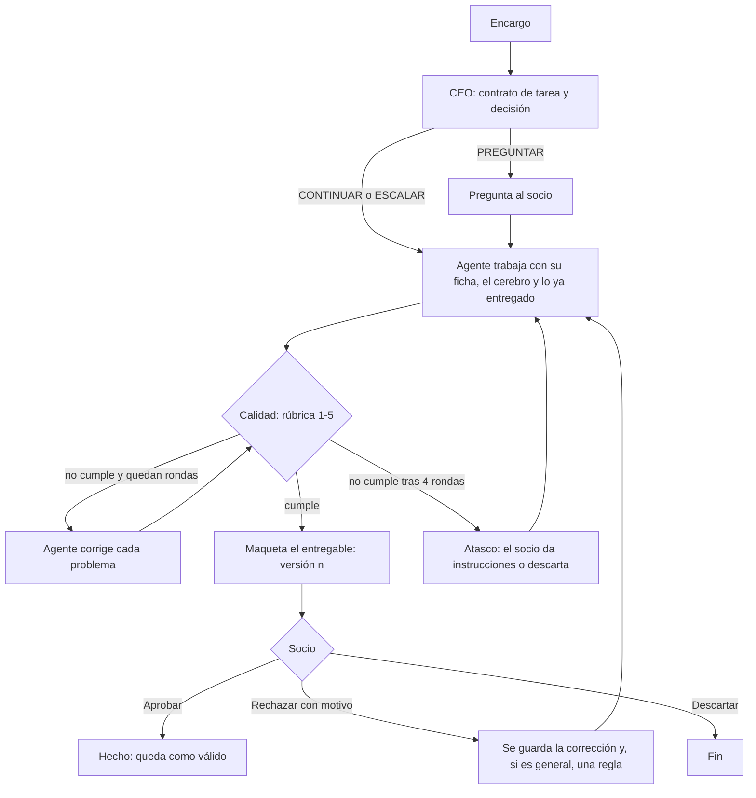

# 18 · Flujo de calidad y aprendizaje continuo en la oficina

Cómo pasa un encargo de la oficina de agentes de borrador a «aprobado» y qué aprende la oficina en cada vuelta (D-019). Vale para la oficina interna; la matriz de aprobaciones por riesgo del producto (docs/14) no cambia.

## El flujo, sin huecos

| Paso | Quién | Regla fija |
|---|---|---|
| Revisión | Calidad | Seis criterios de 1 a 5: criterio, completo, veracidad, coherencia, nivel y forma. Cumple solo si todos ≥ 4, media ≥ 4,5 y ningún problema grave ni medio. Lo calcula el código. |
| Rondas | Agente y Calidad | Hasta 4. En cada ronda el agente recibe la lista de problemas con dónde y cómo arreglarlos; Calidad comprueba que se han corregido los anteriores. |
| Llega al socio | — | Solo lo que ha pasado Calidad. Todo lo que pasa Calidad espera el OK de un socio. |
| Atasco | Socio | Si no cumple tras 4 rondas, no se presenta para aprobar: el socio da instrucciones (se rehace) o lo descarta. |
| Rechazo | Socio | El motivo es obligatorio. El agente rehace la entrega con él y con los rechazos anteriores, vuelve a pasar Calidad y llega otra vez como versión nueva. |
| Dependencias | Orquestador del plan | Un encargo empieza cuando los que necesita han pasado Calidad. Si uno se rehace, los que dependían de él se actualizan solos y vuelven a pasar Calidad. |
| Fin del plan | — | Cuando un socio ha aprobado todos los encargos. |

Para los entregables al cliente, los descriptores de cada nivel y las listas de comprobación por tipo están en [knowledge/plantillas/entregables/rubrica.md](../knowledge/plantillas/entregables/rubrica.md). La misma regla está en código en `src/varios/calidad/rubrica.py` (C3).

## Qué aprende y dónde queda
- **Cada rechazo** queda en la memoria como corrección. Si el CEO lo clasifica como general, se convierte en una regla fija del agente.
- **Cada atasco en Calidad** queda en la memoria con lo que indicó el socio.
- **Fallos repetidos:** si Calidad devuelve a un agente el mismo tipo de fallo en dos encargos distintos, se añade una regla fija suya marcada «aprendida de Calidad». Se puede editar o borrar en su ficha.
- **Cada versión entregada** deja un precedente y una lección.
- Todo eso se vuelca cada noche al repositorio (D-017) y entra en el cerebro.

## Límites conocidos
- Más rondas son más tokens: un encargo puede costar hasta cinco veces más si Calidad lo devuelve cuatro veces.
- Calidad es otro modelo: es exigente, pero no infalible. Por eso el último filtro es siempre un socio.
- El flujo avanza solo con la oficina abierta.
