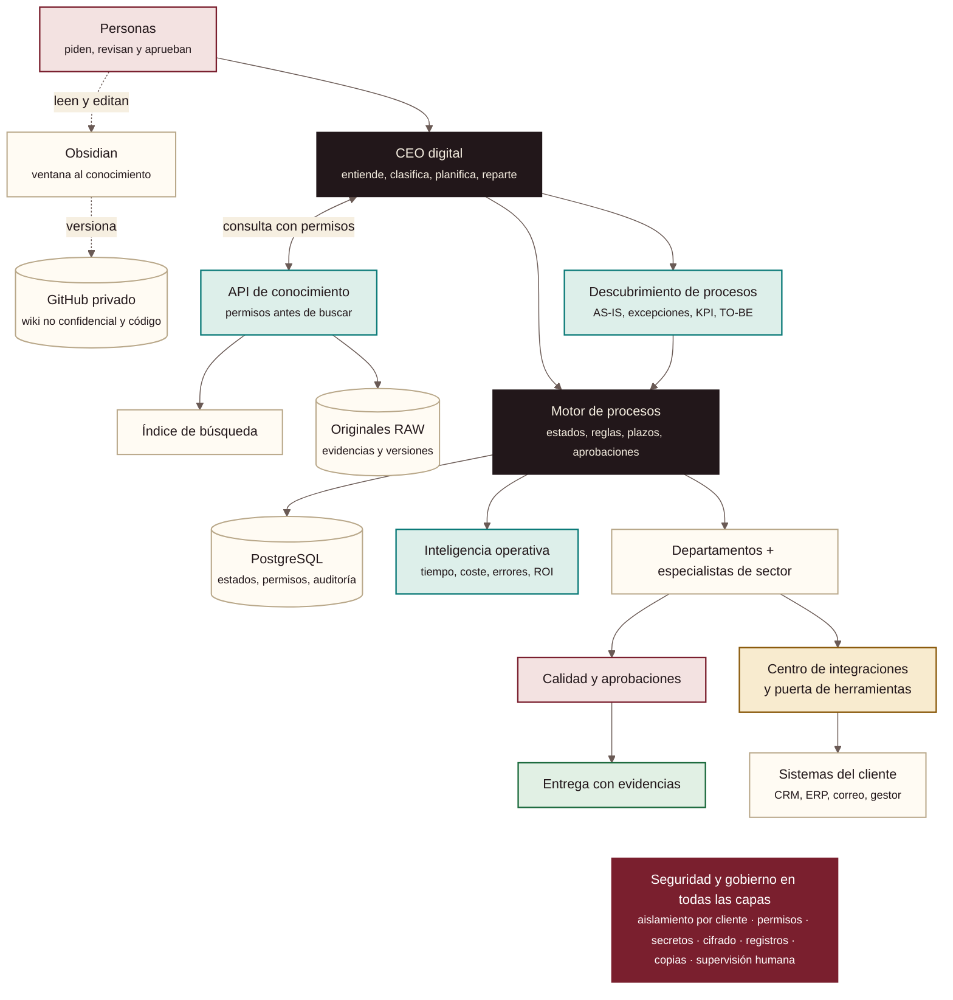

# 00 · Arquitectura del cerebro digital

_Las capas del sistema, de arriba (personas) a abajo (datos), con la seguridad cruzándolo todo._

**Fuente:** Imagen de WhatsApp del 16/11/2026 + Atlas Evolución v1.1, apartado 2

## En palabras sencillas

Piensa en un edificio de cuatro plantas. Arriba trabajan las personas. Debajo está la dirección (el CEO digital), que entiende el encargo y lo reparte. El motor de procesos lleva el control de cada tarea. Los departamentos hacen el trabajo y solo tocan los programas del cliente a través de una puerta vigilada. En el sótano están los datos y el conocimiento. La seguridad atraviesa todas las plantas.

## Diagrama

## Pasos

1. La petición entra por las personas o por un canal.
2. El CEO la entiende y decide: si hace falta, primero se descubre el proceso real.
3. El motor de procesos ejecuta las tareas con reglas y plazos.
4. Los departamentos trabajan y solo tocan sistemas del cliente a través de la puerta de herramientas.
5. Calidad y personas revisan antes de entregar.
6. Todo lo que pasa queda en PostgreSQL; el conocimiento validado, en la wiki.

## Si algo falla

- Si el conocimiento no tiene permiso, no se recupera, aunque exista.
- Obsidian no es la base de datos ni el sistema de permisos: solo es la ventana para leer y escribir.

## Qué tiene que existir

- Mapa de módulos con responsables
- Lista de qué vive en PostgreSQL, qué en Git y qué en almacenamiento privado

## Correcciones respecto al original

- El original tenía texto que se salía de las cajas y una flecha larga que cruzaba todo el dibujo. Ahora cada flecha va de una caja a la siguiente.
- Se añaden los módulos que pide el Atlas de Evolución: descubrimiento de procesos, motor de procesos, centro de integraciones e inteligencia operativa.
