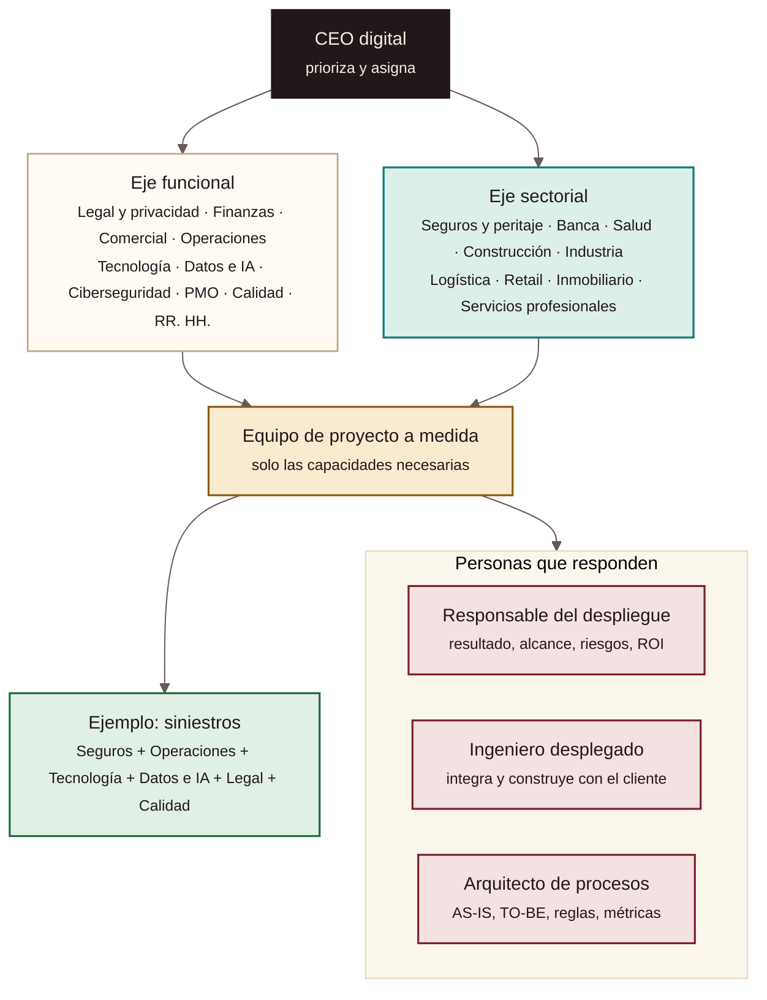

# 01 · Organización: modelo matricial

_Dos ejes que se combinan por proyecto, más las personas que responden del resultado._

**Fuente:** Guía v1.4, diagrama 2 + Atlas Evolución v1.1, apartados 4 y 4.1

## En palabras sencillas

No hay un robot para cada combinación. Hay departamentos que sirven para cualquier sector y especialistas de sector que se llaman cuando hace falta. Para cada cliente se forma un equipo a medida. Y siempre hay personas que responden: el responsable del despliegue y el ingeniero que trabaja con el cliente.

## Diagrama

## Pasos

1. El CEO identifica qué funciones y qué sector necesita el encargo.
2. Se combinan solo esas capacidades en un equipo de proyecto.
3. Una persona (responsable del despliegue) responde del resultado. La responsabilidad final nunca se delega en la IA.

## Si algo falla

- Si falta una capacidad, se deriva a un profesional externo en lugar de improvisarla.
- Un paquete sectorial no se lanza hasta tener un cliente con datos autorizados y una métrica de valor.

## Qué tiene que existir

- Catálogo de capacidades con responsable, versión, permisos y coste
- Equipo y responsables de cada proyecto (matriz RACI)

## Correcciones respecto al original

- El Atlas de Evolución pedía añadir al mapa de organización el responsable del despliegue, el ingeniero desplegado y el arquitecto de procesos. No estaba hecho; ahora sí.
