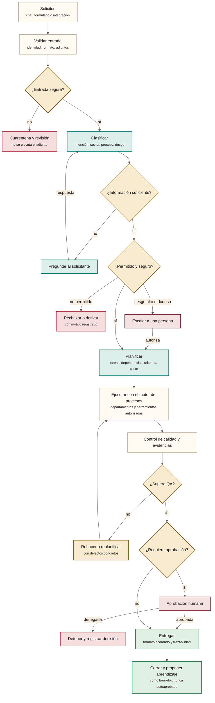

# 02 · Flujo completo del CEO digital

_De la petición a la entrega, con todos los desvíos: preguntar, rechazar, escalar, rehacer y aprobar._

**Fuente:** Atlas · Mapa 2, versión 1.0

## En palabras sencillas

Este es el camino de cualquier encargo. Lo importante son los rombos: en cada uno el CEO puede parar. Si falta información, pregunta. Si no está permitido, rechaza o deriva. Si la calidad falla, se rehace. Si el riesgo lo exige, una persona aprueba antes de entregar.

## Diagrama

## Pasos

1. Registrar solicitud, solicitante, cliente, fecha y adjuntos.
2. Validar identidad, formato, adjuntos y autorización.
3. Clasificar intención, sector, proceso, sensibilidad, riesgo y confianza.
4. Si falta información esencial, preguntar.
5. Comprobar alcance, política y permisos antes de planificar.
6. Crear el plan con responsables, dependencias y criterios de éxito.
7. Ejecutar con herramientas autorizadas.
8. Validar resultados contra fuentes y criterios.
9. Pedir aprobación humana si corresponde.
10. Entregar, registrar y cerrar; el aprendizaje se propone aparte.

## Si algo falla

- Entrada sospechosa: cuarentena; nunca se ejecuta el adjunto.
- Baja confianza: preguntar, no forzar la clasificación.
- Fuera de alcance: rechazar o proponer una alternativa segura.
- Fallo de tarea: reintento limitado o escalado.
- QA no superado: vuelve a ejecución con defectos concretos.
- Aprobación denegada: se detiene la acción y se registra.

## Qué tiene que existir

- Solicitud normalizada
- Ficha de clasificación y riesgo
- Plan de ejecución
- Registro de aprobaciones
- Paquete de entrega y cierre

## Correcciones respecto al original

- En el original, la entrega iba antes de la aprobación humana, al revés de lo que dice su propio texto (paso 9 aprobar, paso 10 entregar). Corregido: primero se aprueba y después se entrega.
- Faltaban en el dibujo los caminos de rechazar, escalar y cuarentena que el texto sí describe.
- Las etiquetas "no / respuesta" y "baja confianza" se pisaban. Ahora cada flecha tiene su etiqueta.
