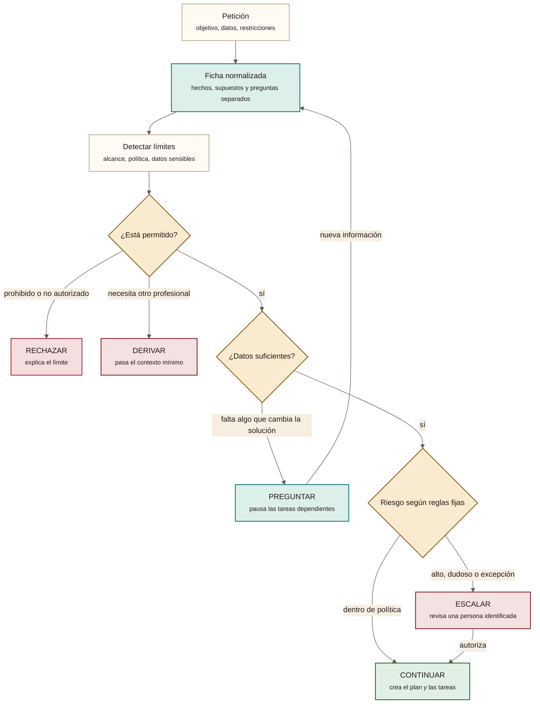

# 03 · Las cinco decisiones del CEO

_La clasificación no es una etiqueta: termina siempre en una decisión auditable._

**Fuente:** Guía v1.4, Anexo III apartados 2 y 2.2 + diagrama 11

## En palabras sencillas

Después de entender un encargo, el CEO solo puede hacer una de cinco cosas: seguir, preguntar, escalar a una persona, rechazar o derivar a otro profesional. Siempre deja escrito por qué. La confianza que diga la IA es una pista, nunca un permiso.

## Diagrama

## Pasos

1. Recepción con identidad y cliente.
2. Normalización: separa hechos, supuestos y preguntas. El usuario puede corregirla.
3. Detección de límites: alcance, política, datos sensibles, conflicto de interés.
4. Clasificación con razones y campos desconocidos marcados.
5. Suficiencia: ¿hay datos para planificar?
6. Riesgo y autonomía con reglas fijas.
7. Equipo y plan versionado.
8. Supervisión: si cambia algo importante, se pausa y se replanifica.

## Si algo falla

- Cada campo se marca como confirmado, inferido o desconocido. No se usa un umbral tipo "80 % de confianza" sin calibrarlo antes.
- Seguridad, permisos, pagos, comunicaciones externas y efectos irreversibles nunca se habilitan por la puntuación del modelo.

## Qué tiene que existir

- Registro de la decisión con su motivo
- Política de parada por criticidad

## Correcciones respecto al original

- El diagrama original tenía flechas que salían de la misma caja con etiquetas superpuestas. Se rehace con las cinco decisiones con nombre propio, tal como las define el texto.
