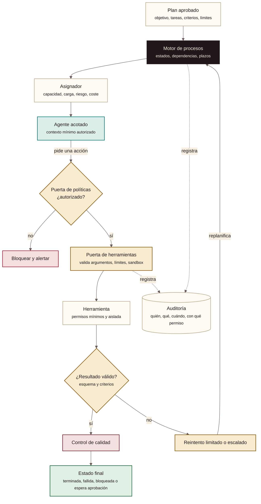

# 04 · Ejecución: motor de procesos, agentes y herramientas

_El plan se convierte en tareas controladas por estados. Ningún agente actúa libremente._

**Fuente:** Atlas · Mapa 4 + Atlas Evolución v1.1, apartado 3.2

## En palabras sencillas

Cuando el plan está aprobado, el motor de procesos lo convierte en tareas. Cada tarea va a un agente con lo justo para trabajar. Si el agente quiere usar una herramienta, tiene que pedir permiso en una puerta. El resultado se comprueba, y si falla se reintenta con límite o se escala. Todo queda registrado.

## Diagrama

## Pasos

1. El motor crea tareas con identificador y estado.
2. El asignador elige capacidad y modelo según política.
3. Se prepara el contexto mínimo autorizado.
4. La puerta valida identidad, argumentos, alcance y presupuesto.
5. La herramienta se ejecuta con permisos mínimos.
6. El resultado se valida contra esquema y criterios.
7. Se registra traza y coste.
8. Si falla: reintento limitado, compensación o escalado.
9. QA y aprobación antes de entregar.

## Si algo falla

- Tiempo agotado: cancelar si es seguro y reintentar con espera creciente.
- Respuesta mal formada: se rechaza y no se propaga.
- Herramienta no autorizada: se bloquea y se avisa.
- Efecto duplicado: claves de idempotencia y conciliación.
- Agente en bucle o coste excesivo: límites y botón de parada.

## Qué tiene que existir

- Catálogo de herramientas
- Máquina de estados
- Política de reintentos e idempotencia
- Registro de ejecuciones y costes
- Evaluaciones de agentes

## Correcciones respecto al original

- Se añade el motor de procesos y la salida "bloquear" de la puerta de políticas, que pedía el Atlas de Evolución.
- La flecha "replanifica" cruzaba toda la imagen por encima de otras cajas. Ahora vuelve limpia al motor.
