# 05 · Puerta de herramientas

_Ningún agente tiene contraseñas ni acceso directo: pide la acción a una puerta que decide._

**Fuente:** Guía v1.4, diagrama 12 y Anexo III apartado 5

## En palabras sencillas

Es como el control de acceso de un edificio. El agente pide hacer algo. La puerta comprueba quién lo pide, para qué cliente y si está permitido. Si es algo serio (enviar, pagar, borrar), espera a que una persona lo apruebe. Solo entonces se hace, aislado y registrado.

## Diagrama

```mermaid
%%{init: {'theme':'base','themeVariables':{'fontFamily':'Instrument Sans, Helvetica, Arial, sans-serif','fontSize':'15px','primaryColor':'#FFFBF3','primaryBorderColor':'#B9A88A','primaryTextColor':'#22171A','lineColor':'#6A5A55','edgeLabelBackground':'#F6EFE1','clusterBkg':'#FBF6EC','clusterBorder':'#E4D6BC','tertiaryColor':'#FFFFFF'},'flowchart':{'curve':'basis','padding':14,'nodeSpacing':38,'rankSpacing':46}}}%%
flowchart LR
A["Agente o CEO<br/><small>propone una acción</small>"]:::ia -- "solicitud estructurada" --> B["Puerta de herramientas<br/><small>identidad, cliente, política</small>"]:::dec
B --> C{"¿Autorizada?"}:::dec
C -- "no" --> D["Denegar y alertar"]:::bad
C -- "sí" --> E["Alcance mínimo<br/><small>cliente, recurso, operación</small>"]:::re
E --> F{"¿Requiere aprobación?"}:::dec
F -- "preautorizada" --> G["Ejecución aislada<br/><small>secretos fuera del prompt, límites</small>"]:::re
F -- "sí: externa o irreversible" --> H["Aprobación humana<br/><small>sobre el contenido exacto</small>"]:::pe
H -- "aprobada" --> G
H -- "denegada" --> D
G --> I[("Registro y evidencia<br/><small>quién, qué, cuándo, resultado</small>")]:::ok
classDef ia fill:#DDEFEA,stroke:#0B7A78,stroke-width:1.6px,color:#22171A
classDef re fill:#FFFBF3,stroke:#B9A88A,stroke-width:1.4px,color:#22171A
classDef pe fill:#F3E2E1,stroke:#7A1F2E,stroke-width:1.6px,color:#22171A
classDef dec fill:#F8EBCF,stroke:#8A5A0C,stroke-width:1.6px,color:#22171A
classDef bad fill:#F6DEDF,stroke:#A8283A,stroke-width:1.6px,color:#22171A
classDef ok fill:#E1F0E4,stroke:#1D6B3E,stroke-width:1.6px,color:#22171A
classDef core fill:#22171A,stroke:#22171A,color:#F6EFE1
classDef wine fill:#7A1F2E,stroke:#7A1F2E,color:#FFFFFF
```

## Pasos

1. Catálogo: cada herramienta declara finalidad, responsable, entradas, permisos, riesgos y límites.
2. Denegar por defecto; lista cerrada de operaciones.
3. Credenciales distintas por entorno y alcance mínimo.
4. Sandbox cuando se ejecuta código o contenido no confiable.
5. Validar parámetros: tamaños, rutas, dominios.
6. Aprobación vinculada al contenido exacto para acciones externas, financieras o destructivas.
7. Registro completo con parámetros redactados.
8. Botón de parada por herramienta, proyecto, cliente y sistema.

## Si algo falla

- Las instrucciones que aparezcan dentro de un documento o correo nunca pueden activar una herramienta.
- No se reintentan errores de permisos ni de política.

## Qué tiene que existir

- Catálogo de herramientas
- Matriz de aprobaciones por tipo de acción

## Correcciones respecto al original

- En el original las flechas de "no autorizada" y "autorizada" salían del mismo punto y casi se tocaban. Ahora la decisión es un rombo con dos salidas claras.
