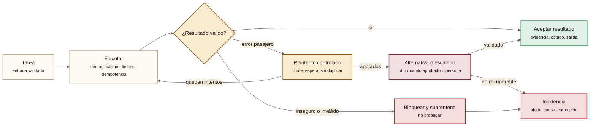

# 06 · Fallos, reintentos y recuperación

_Nada se reintenta para siempre. Lo dudoso no se propaga._

**Fuente:** Guía v1.4, diagrama 13 y Anexo III apartado 4.1

## En palabras sencillas

Si algo sale mal, el sistema distingue: un fallo pasajero se reintenta unas pocas veces; si se agotan los intentos, se prueba otra vía o se pasa a una persona; si el resultado parece peligroso, se aparta y se abre una incidencia. Nunca se repite una acción que ya se hizo, como un pago.

## Diagrama

## Pasos

1. Clasificar el error: pasajero, permanente, funcional, de permisos o de seguridad.
2. Tiempo máximo y número de intentos configurables, con espera creciente.
3. Antes de reintentar una acción externa, comprobar si ya se ejecutó.
4. Agotados los intentos: bloqueado o escalado, con evidencia y alternativa manual.
5. El estado persiste: reiniciar el sistema no pierde ni duplica tareas.

## Si algo falla

- Los errores de permisos o de política no se reintentan nunca.

## Qué tiene que existir

- Política de reintentos
- Claves de idempotencia
- Procedimiento manual alternativo

## Correcciones respecto al original

- El original tenía la etiqueta "Sí" lejos de su flecha y una línea de vuelta que pasaba por debajo de otras cajas.
