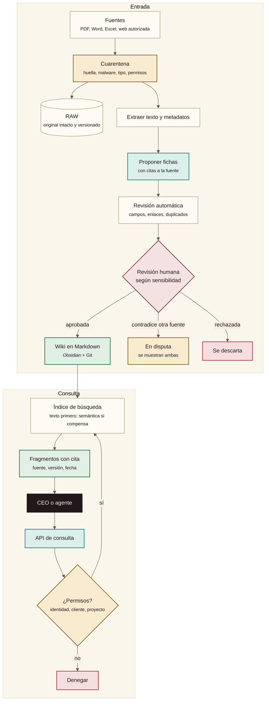

# 07 · Motor de conocimiento con Obsidian

_Cómo entra un documento, cómo se convierte en conocimiento aprobado y cómo se consulta con permisos._

**Fuente:** Atlas · Mapa 3 + Guía v1.4, diagrama 5 y Anexo III apartado 6

## En palabras sencillas

Arriba, el camino de entrada: el documento pasa por una aduana, se guarda el original intacto y la IA propone fichas que una persona aprueba. Abajo, el camino de consulta: antes de buscar se comprueban los permisos, y la respuesta siempre dice de dónde sale.

## Diagrama

## Pasos

1. Recibir el documento en cuarentena.
2. Calcular huella, analizar tipo, malware y permisos.
3. Extraer texto y metadatos sin perder el vínculo al original.
4. Proponer fichas en Markdown con citas.
5. Revisión automática: campos obligatorios, enlaces, duplicados.
6. Revisión humana según sensibilidad.
7. Publicar en la wiki y versionar en Git si la clasificación lo permite.
8. Indexar solo lo autorizado.
9. Recuperar fragmentos con referencias.
10. Tras cada proyecto, proponer mejoras; nunca autoaprobarlas.

## Si algo falla

- Extracción incompleta: calidad baja y revisión manual.
- Fuentes contradictorias: estado en disputa.
- Fuente obsoleta: deprecada, sin borrar la evidencia histórica.
- Sin permiso: se deniega aunque exista en el índice.
- Datos confidenciales de un cliente: nunca en la wiki común.

## Qué tiene que existir

- Plantillas Markdown y metadatos
- Política de clasificación y estados
- Proceso de ingesta y revisión
- Índice y política de recuperación
- Registro de procedencia

## Correcciones respecto al original

- La flecha "conserva original" cruzaba en diagonal por encima de tres cajas, y las de "indexa" y "versiona" se cortaban. Se separa en dos caminos, entrada y consulta, que no se cruzan.
