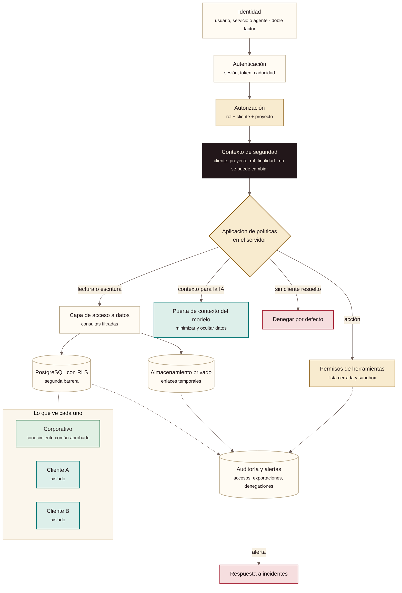

# 08 · Seguridad, identidad y aislamiento de clientes

_La autorización ocurre en el servidor. No se confía en instrucciones a la IA, carpetas ni filtros de pantalla._

**Fuente:** Atlas · Mapa 5 + Guía v1.4, diagrama 6 y Anexo III apartado 7

## En palabras sencillas

Cada petición lleva una identidad verificada. De ella sale de qué cliente es y qué puede ver, y eso no lo puede cambiar ni el usuario ni la IA. Con ese pase se consulta la base de datos, los archivos y las herramientas. A la IA le llega solo lo mínimo. Todo acceso, y todo intento denegado, queda registrado.

## Diagrama

## Pasos

1. Autenticar usuario o servicio.
2. Resolver cliente y permisos desde la identidad.
3. Construir un contexto de seguridad que no se puede modificar.
4. Autorizar cada lectura, escritura, exportación y herramienta.
5. RLS y controles de almacenamiento como segunda barrera.
6. Minimizar el contexto antes de enviarlo a un modelo externo.
7. Registrar accesos y denegaciones sin volcar secretos.
8. Detectar y gestionar incidentes.

## Si algo falla

- Cliente no resuelto: denegar por defecto.
- Token caducado: rechazar y volver a autenticar.
- RLS mal configurada: no se despliega hasta pasar las pruebas.
- Fuga o acceso cruzado: revocar, contener, preservar evidencias.
- Proveedor o modelo no aprobado: no se le envían datos confidenciales.

## Qué tiene que existir

- Modelo de amenazas
- Matriz de acceso
- Políticas RLS y pruebas negativas
- Inventario de datos y proveedores
- Plan de respuesta a incidentes

## Prueba de aceptación

Prueba de aceptación: dos clientes de prueba con datos señuelo únicos. Se intenta leer, buscar, exportar y usar herramientas de uno desde el otro. Cualquier fuga bloquea el lanzamiento.

## Correcciones respecto al original

- El original tenía cinco flechas diagonales que salían del mismo punto y se cruzaban sobre "PostgreSQL RLS", con etiquetas ilegibles como "archivo" y "tool scope" superpuestas. Se reorganiza en un árbol de decisión.
