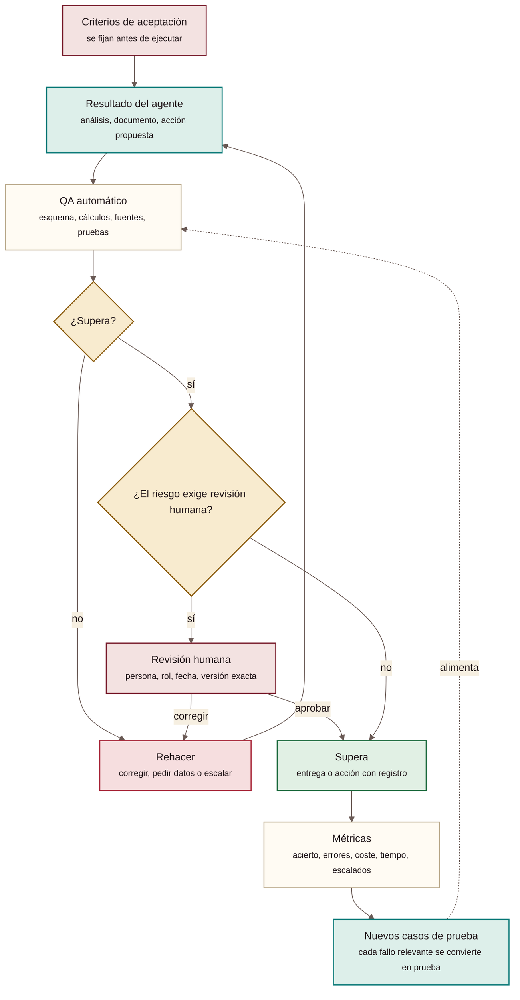

# 09 · Calidad, evaluación y aprobación humana

_No se confunde una respuesta convincente con un resultado correcto y autorizado._

**Fuente:** Atlas · Mapa 6 + Guía v1.4, diagrama 8 y Anexo III apartado 9

## En palabras sencillas

Los criterios de "bien hecho" se escriben antes de empezar. Primero comprueban las reglas automáticas; después, si el riesgo lo pide, una persona. Lo que falla vuelve a rehacerse. Y cada error que se encuentra se convierte en una prueba nueva para que no se repita.

## Diagrama

## Pasos

1. Definir aceptación, nivel de riesgo y revisor.
2. Validaciones automáticas fijas.
3. Evaluar calidad y fundamentación con pruebas controladas.
4. Revisión humana para tareas de riesgo.
5. Registrar decisión, versión y evidencias.
6. Medir calidad, coste, tiempo, fallos y escalados.
7. Convertir fallos en nuevos casos de prueba.

## Si algo falla

- Sin criterio de aceptación no se marca como terminado.
- Evaluadores no calibrados: no se automatiza la aprobación.
- Regresión detectada: se bloquea la versión y se revierte.
- Desacuerdo entre evaluadores: decide un experto humano.
- El agente que propone nunca se aprueba a sí mismo.

## Qué tiene que existir

- Conjunto de pruebas con versión (normales, límite y ataques)
- Umbrales por caso de uso
- Registro de aprobaciones

## Correcciones respecto al original

- El original mezclaba en un solo dibujo el control de cada resultado y el control de cambios del sistema, con cuatro flechas diagonales cruzadas ("mide", "registra", "añade casos"). Se separan: este mapa es el control de cada resultado; el de cambios va en el mapa 10.
