# 10 · Cambios y elección de modelos de IA

_Ningún cambio de modelo, instrucción o herramienta llega a producción sin volver a pasar las pruebas._

**Fuente:** Guía v1.4, diagrama 14 y Anexo III apartado 8 + Atlas · Mapa 6

## En palabras sencillas

Cada tipo de tarea tiene un modelo de IA aprobado. Si queremos cambiarlo, o cambiar sus instrucciones, se vuelve a examinar con las mismas pruebas. Si no aprueba, no se usa. Si un modelo en uso empeora, se detecta y se vuelve a evaluar.

## Diagrama

```mermaid
%%{init: {'theme':'base','themeVariables':{'fontFamily':'Instrument Sans, Helvetica, Arial, sans-serif','fontSize':'15px','primaryColor':'#FFFBF3','primaryBorderColor':'#B9A88A','primaryTextColor':'#22171A','lineColor':'#6A5A55','edgeLabelBackground':'#F6EFE1','clusterBkg':'#FBF6EC','clusterBorder':'#E4D6BC','tertiaryColor':'#FFFFFF'},'flowchart':{'curve':'basis','padding':14,'nodeSpacing':38,'rankSpacing':46}}}%%
flowchart LR
T["Tipo de tarea<br/><small>riesgo, sensibilidad, complejidad</small>"]:::re --> RR["Reglas de enrutamiento<br/><small>privacidad, calidad mínima, coste</small>"]:::dec
RR --> MA["Modelo aprobado<br/><small>versión fija y límites</small>"]:::re
MA --> EV{"Evaluación<br/><small>pruebas, casos límite, regresión</small>"}:::dec
EV -- "supera" --> AP["Apto para producción"]:::ok
EV -- "no supera" --> NA["No apto<br/><small>alternativa aprobada o revisión humana</small>"]:::bad
AP --> MO["Monitorización<br/><small>calidad, coste, tiempo, deriva</small>"]:::re
MO -- "empeora o hay propuesta de cambio" --> CC["Cambio controlado<br/><small>prompt, modelo, herramienta, esquema</small>"]:::pe
CC -- "nueva evaluación" --> EV
AP -.-> RB["Reversión preparada<br/><small>siempre se puede volver atrás</small>"]:::re
classDef ia fill:#DDEFEA,stroke:#0B7A78,stroke-width:1.6px,color:#22171A
classDef re fill:#FFFBF3,stroke:#B9A88A,stroke-width:1.4px,color:#22171A
classDef pe fill:#F3E2E1,stroke:#7A1F2E,stroke-width:1.6px,color:#22171A
classDef dec fill:#F8EBCF,stroke:#8A5A0C,stroke-width:1.6px,color:#22171A
classDef bad fill:#F6DEDF,stroke:#A8283A,stroke-width:1.6px,color:#22171A
classDef ok fill:#E1F0E4,stroke:#1D6B3E,stroke-width:1.6px,color:#22171A
classDef core fill:#22171A,stroke:#22171A,color:#F6EFE1
classDef wine fill:#7A1F2E,stroke:#7A1F2E,color:#FFFFFF
```

## Pasos

1. Registro de modelos: proveedor, versión, región, condiciones, retención, usos autorizados.
2. Enrutamiento por política, no a elección del CEO.
3. Alternativas solo hacia modelos ya evaluados para ese nivel de datos.
4. Instrucciones (prompts) versionadas en Git y con pruebas de regresión.
5. Cambiar de proveedor obliga a revisar privacidad, contrato y salida.
6. Presupuesto por proyecto y cliente con corte automático.

## Si algo falla

- Si no hay modelo alternativo aprobado, se pausa o se degrada de forma segura.

## Qué tiene que existir

- Registro de modelos
- Instrucciones versionadas
- Informe de evaluación por versión

## Correcciones respecto al original

- Reúne la parte de "cambios controlados" del mapa 6 original, que estaba enredada con el control de resultados.
