# 11 · Infraestructura, desarrollo y portabilidad

_Empezar gratis y con piezas sustituibles, sin depender del Mac._

**Fuente:** Atlas · Mapa 7

## En palabras sencillas

El código se escribe en el Mac, pero vive en GitHub. Desde ahí se despliega a la nube. La aplicación usa una base de datos estándar, un almacén de archivos y un adaptador para el modelo de IA, de forma que cualquier pieza se puede cambiar. Las copias de seguridad se prueban restaurándolas de verdad.

## Diagrama

```mermaid
%%{init: {'theme':'base','themeVariables':{'fontFamily':'Instrument Sans, Helvetica, Arial, sans-serif','fontSize':'15px','primaryColor':'#FFFBF3','primaryBorderColor':'#B9A88A','primaryTextColor':'#22171A','lineColor':'#6A5A55','edgeLabelBackground':'#F6EFE1','clusterBkg':'#FBF6EC','clusterBorder':'#E4D6BC','tertiaryColor':'#FFFFFF'},'flowchart':{'curve':'basis','padding':14,'nodeSpacing':38,'rankSpacing':46}}}%%
flowchart LR
subgraph DEV["Desarrollo"]
  direction LR
  MAC["Mac<br/><small>VS Code, Python, Claude</small>"]:::re --> GL["Git local<br/><small>ramas, commits, tests</small>"]:::re
  GL -- "push" --> GH["GitHub privado<br/><small>repositorio, CI, versiones</small>"]:::ia
end
GH -- "despliegue" --> DP["Despliegue reproducible<br/><small>secretos fuera del código, aprobación</small>"]:::dec
DP --> API["API y procesos<br/><small>FastAPI</small>"]:::core
subgraph RUN["Ejecución"]
  direction TB
  API --> PG[("PostgreSQL estándar")]:::re
  API --> OS[("Almacén de archivos<br/><small>compatible S3</small>")]:::re
  API --> MA["Adaptador de modelos<br/><small>Claude al inicio, cambiable</small>"]:::ia
  API --> OB["Observabilidad<br/><small>logs, métricas, alertas</small>"]:::re
end
PG -- "copia" --> BK[("Copias<br/><small>base y archivos por separado</small>")]:::re
OS -- "copia" --> BK
BK -- "prueba" --> RT["Prueba de restauración<br/><small>periódica y documentada</small>"]:::pe
RT -- "valida" --> MP["Camino de migración<br/><small>Docker, variables, migraciones, exportación</small>"]:::ok
classDef ia fill:#DDEFEA,stroke:#0B7A78,stroke-width:1.6px,color:#22171A
classDef re fill:#FFFBF3,stroke:#B9A88A,stroke-width:1.4px,color:#22171A
classDef pe fill:#F3E2E1,stroke:#7A1F2E,stroke-width:1.6px,color:#22171A
classDef dec fill:#F8EBCF,stroke:#8A5A0C,stroke-width:1.6px,color:#22171A
classDef bad fill:#F6DEDF,stroke:#A8283A,stroke-width:1.6px,color:#22171A
classDef ok fill:#E1F0E4,stroke:#1D6B3E,stroke-width:1.6px,color:#22171A
classDef core fill:#22171A,stroke:#22171A,color:#F6EFE1
classDef wine fill:#7A1F2E,stroke:#7A1F2E,color:#FFFFFF
```

## Pasos

1. Repositorio privado con estructura reproducible.
2. Desarrollo local con tests y dependencias fijadas.
3. PostgreSQL local o gestionado.
4. Demo en la nube solo cuando aporte valor.
5. Adaptador de modelos y almacenamiento desacoplados.
6. Exportar base y archivos; probar restauración en un entorno limpio.
7. Antes de datos reales, pasar a un plan de producción.

## Si algo falla

- El proveedor gratuito pausa o borra: se recrea desde código, migraciones y copias.
- Límite de cuota: alertar y degradar con control.
- Región no adecuada: no se cargan datos.
- Migración fallida: mantener origen y restaurar.

## Qué tiene que existir

- Docker Compose y migraciones
- Guía de despliegue y recuperación
- Inventario de proveedores y regiones

## Correcciones respecto al original

- La flecha "publica" cruzaba en diagonal todo el dibujo y las etiquetas "archivos" e "inferencias" se pisaban. Se agrupa por zonas: desarrollo, ejecución y copias.
