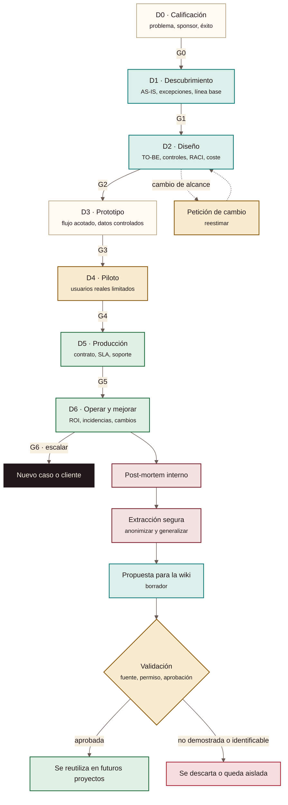

# 12 · Ciclo de vida de un proyecto con cliente

_Fases D0 a D6, con su control de paso, y cómo se aprende sin mezclar clientes._

**Fuente:** Atlas · Mapa 8 + Atlas Evolución v1.1, apartado 3.5 + Guía v1.4, diagramas 7 y 9

## En palabras sencillas

Así avanza un cliente: se califica la oportunidad, se descubre el proceso, se diseña, se prueba en pequeño, se pilota y se pasa a producción. En cada paso hay una puerta (G0 a G6). Al cerrar, se aprende, pero lo aprendido se limpia de datos del cliente y lo aprueba una persona antes de reutilizarlo.

## Diagrama

## Pasos

1. Registrar oportunidad y solicitante.
2. Descubrimiento con supuestos y lagunas documentados.
3. Propuesta y plan con riesgos y responsables.
4. Aprobación de alcance y ejecución.
5. Ejecución con evidencias.
6. QA y aceptación del cliente.
7. Entrega y cierre con métricas.
8. Post-mortem interno.
9. Extraer patrones no confidenciales.
10. Proponer y validar antes de publicar en la wiki.

## Si algo falla

- Cambia el alcance: petición de cambio y reestimación.
- El cliente no acepta: registrar defectos y plan de corrección.
- Datos no reutilizables: se descarta el aprendizaje o se mantiene aislado.
- Lección no demostrada: no se publica como método.

## Qué tiene que existir

- Ficha de oportunidad
- Mapa AS-IS y TO-BE
- Métrica de éxito firmada
- Informe de cierre

## Correcciones respecto al original

- El original tenía una flecha "reutiliza en futuros proyectos" que cruzaba "completa" y "QA" en diagonal. Se integran las fases D0–D6 del Atlas de Evolución, que el mapa 8 debía incluir y no incluía.
