# 13 · Ciclo de vida de un dato

_Cada dato entra con una finalidad, se usa con control y se borra cuando ya no hace falta._

**Fuente:** Guía v1.4, diagrama 15 y Anexo III apartado 10

## En palabras sencillas

Un dato no se guarda "por si acaso". Al entrar se sabe para qué es y cuánto tiempo puede quedarse. Se usa lo mínimo y con permiso. Periódicamente se revisa: si ya no hace falta, se borra o se anonimiza, también en copias y derivados, y queda constancia.

## Diagrama

```mermaid
%%{init: {'theme':'base','themeVariables':{'fontFamily':'Instrument Sans, Helvetica, Arial, sans-serif','fontSize':'15px','primaryColor':'#FFFBF3','primaryBorderColor':'#B9A88A','primaryTextColor':'#22171A','lineColor':'#6A5A55','edgeLabelBackground':'#F6EFE1','clusterBkg':'#FBF6EC','clusterBorder':'#E4D6BC','tertiaryColor':'#FFFFFF'},'flowchart':{'curve':'basis','padding':14,'nodeSpacing':38,'rankSpacing':46}}}%%
flowchart LR
CA["Captura<br/><small>finalidad, origen, base jurídica</small>"]:::re --> CL["Clasificar<br/><small>cliente, sensibilidad, retención</small>"]:::dec
CL --> AL[("Almacenar<br/><small>cifrado, separado, con acceso</small>")]:::re
AL --> US["Uso controlado<br/><small>mínimo, con permisos y trazas</small>"]:::ia
US --> RV{"Revisión periódica<br/><small>exactitud, vigencia, necesidad</small>"}:::dec
RV -- "sigue siendo necesario" --> CO["Conservar<br/><small>plazo definido y justificado</small>"]:::ok
RV -- "no necesario o plazo vencido" --> EL["Eliminar o anonimizar<br/><small>incluye copias e índices</small>"]:::bad
CO --> EV[("Evidencia<br/><small>registro de accesos y borrado</small>")]:::re
EL --> EV
classDef ia fill:#DDEFEA,stroke:#0B7A78,stroke-width:1.6px,color:#22171A
classDef re fill:#FFFBF3,stroke:#B9A88A,stroke-width:1.4px,color:#22171A
classDef pe fill:#F3E2E1,stroke:#7A1F2E,stroke-width:1.6px,color:#22171A
classDef dec fill:#F8EBCF,stroke:#8A5A0C,stroke-width:1.6px,color:#22171A
classDef bad fill:#F6DEDF,stroke:#A8283A,stroke-width:1.6px,color:#22171A
classDef ok fill:#E1F0E4,stroke:#1D6B3E,stroke-width:1.6px,color:#22171A
classDef core fill:#22171A,stroke:#22171A,color:#F6EFE1
classDef wine fill:#7A1F2E,stroke:#7A1F2E,color:#FFFFFF
```

## Pasos

1. Alta: minimizar, clasificar, finalidad, permisos y retención.
2. Uso: acceso por necesidad, registro, cifrado.
3. Compartición: revisar destinatario, contrato y autorización.
4. Rectificación: corregir también wiki, índices y derivados.
5. Borrado: sistemas activos y plazos de las copias documentados.
6. Incidente: preservar evidencias y evaluar notificación.

## Si algo falla

- No conservar indefinidamente por comodidad.
- Retención legal cuando proceda.

## Qué tiene que existir

- Ficha de tratamiento por categoría de datos
- Registro de borrados

## Correcciones respecto al original

- En el original, las flechas de "necesario" y "no necesario" salían juntas y la etiqueta quedaba lejos de su flecha.
