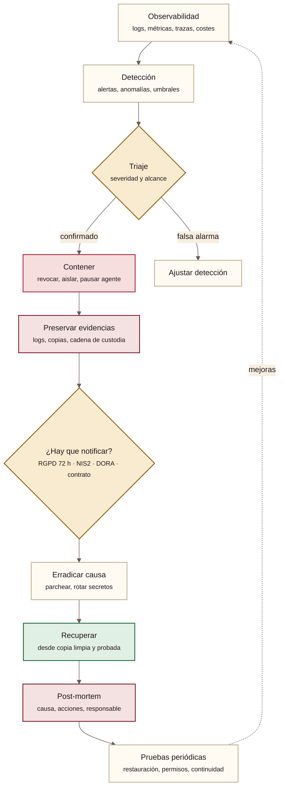

# 14 · Operación y respuesta a incidentes

_Detectar, contener sin borrar pruebas, recuperar y aprender._

**Fuente:** Guía v1.4, diagrama 16 + Marco legal, apartado 10

## En palabras sencillas

Cuando algo raro pasa, primero se aísla para que no vaya a más, sin destruir pruebas. Después se mira a quién afecta y si hay que avisar a alguien por ley (cada norma tiene su reloj). Luego se arregla, se recupera desde una copia limpia y se escribe qué falló para que no vuelva a pasar.

## Diagrama

## Pasos

1. Registrar la hora de detección y nombrar responsable.
2. Contener sin destruir evidencias.
3. Preservar registros y copias.
4. Determinar sistemas, clientes, datos y periodo afectados.
5. Activar privacidad y legal; evaluar cada régimen por separado.
6. Erradicar la causa.
7. Recuperar desde una copia limpia.
8. Comunicar con veracidad.
9. Informe posterior con acciones y responsables.

## Si algo falla

- Crítica: fuga entre clientes, ransomware, toma de control. Activar crisis.
- Alta: acceso no autorizado limitado o proveedor comprometido.
- Media: error de permisos sin explotación.
- Baja: evento bloqueado sin impacto.

## Qué tiene que existir

- Runbooks
- Matriz de relojes de notificación por norma y cliente
- Registro de incidentes

## Correcciones respecto al original

- El original no mostraba la preservación de evidencias ni la evaluación de notificaciones legales, que el Marco legal sí exige. Añadidas.
