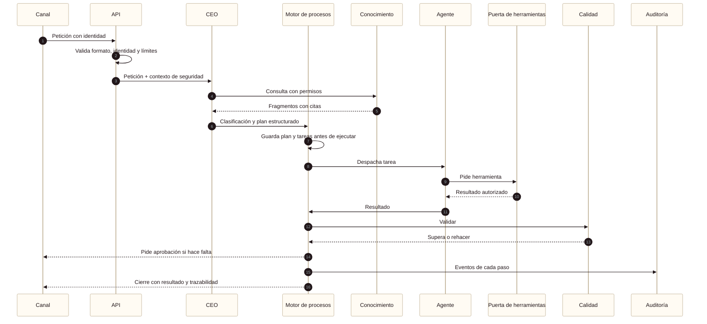

# 15 · Conversación entre componentes

_Qué pieza llama a cuál, en qué orden y qué se guarda. Se lee de arriba abajo._

**Fuente:** Atlas · Mapa 9

## En palabras sencillas

Es la misma petición vista por dentro, como una conversación entre las piezas del sistema. Lo importante: todo se guarda antes de actuar, y cada paso deja un rastro en el registro de auditoría.

## Diagrama

## Pasos

1. El canal envía la petición con identidad.
2. La API valida formato, identidad y límites.
3. El CEO devuelve clasificación y plan estructurado.
4. Se guardan el plan y las tareas antes de ejecutar.
5. Se consulta el conocimiento con contexto autorizado.
6. La tarea va a un agente, que pide herramientas a la puerta.
7. Se guarda el resultado y los eventos de auditoría.
8. Calidad valida y se actualiza el estado.
9. Se pide aprobación cuando hace falta.
10. Se cierra con resultado y trazabilidad.

## Si algo falla

- Contrato inválido: error 400/422 con mensaje claro.
- No autorizado: 403 sin revelar datos.
- Dependencia caída: tiempo máximo, reintento acotado y estado bloqueado.
- Evento duplicado: se descarta por su identificador.
- Resultado perdido: se reconstruye con artefactos y registros.

## Qué tiene que existir

- Contratos versionados entre módulos
- Lista de eventos
- Entidades de datos (ver Procesos)

## Correcciones respecto al original

- El original tenía etiquetas rotas ("artifact ref/vent", "approval / status" encima de una caja) y una flecha de la puerta de herramientas a auditoría que cruzaba todo el dibujo. Un diagrama de secuencia lo muestra sin cruces.
