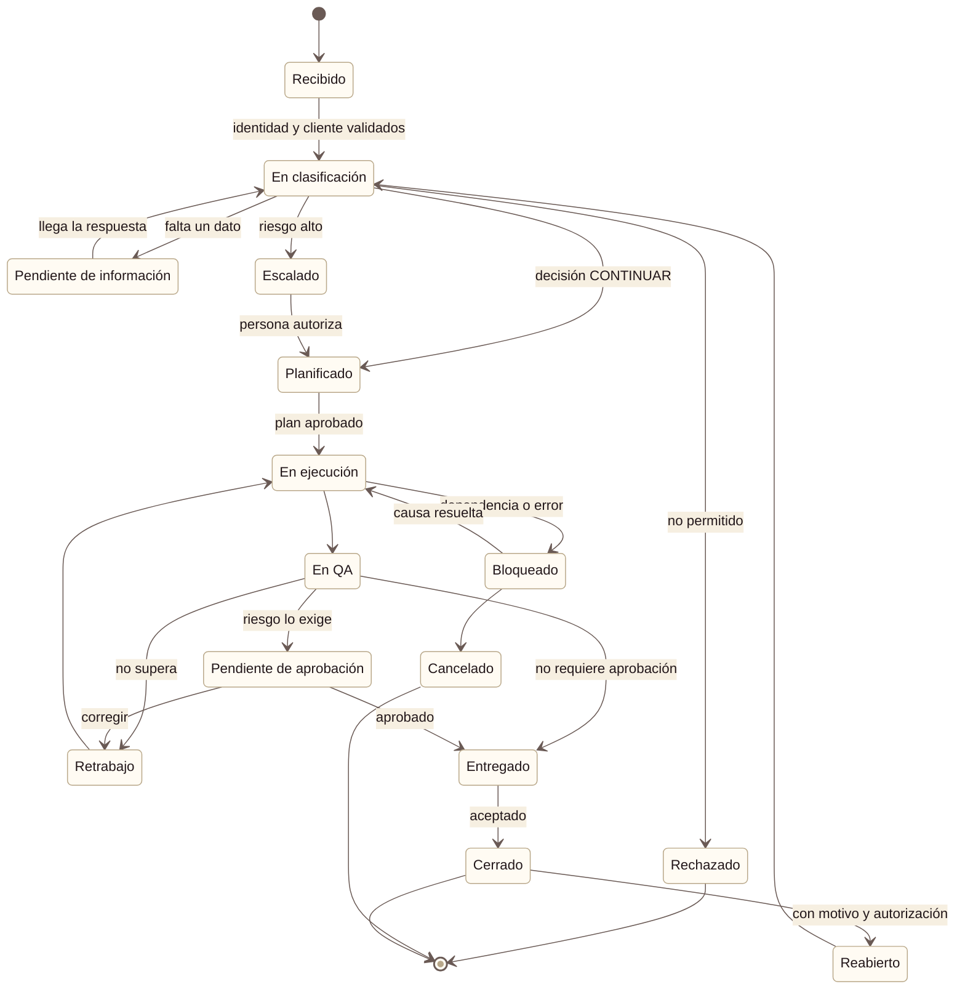

# 16 · Estados de un encargo

_Por dónde puede pasar un encargo y quién puede moverlo de un estado a otro._

**Fuente:** Guía v1.4, Anexo I (estados mínimos) y Anexo III apartado 4

## En palabras sencillas

Un encargo siempre está en un único estado. Solo puede pasar a los estados que marcan las flechas, y cada cambio deja escrito quién lo hizo, cuándo y por qué. Así nunca se pierde el hilo de un caso.

## Diagrama

## Pasos

1. Recibido → En clasificación: se validan identidad y cliente.
2. En clasificación → Pendiente de información / Planificado / Escalado / Rechazado: decisión del CEO con motivo.
3. Planificado → En ejecución: plan aprobado según riesgo y presupuesto.
4. En ejecución → Bloqueado / En QA.
5. En QA → Retrabajo / Pendiente de aprobación / Entregado.
6. Entregado → Cerrado; Cerrado → Reabierto solo con motivo y autorización.

## Si algo falla

- QA no puede aprobar lo que no ha comprobado.
- Quien aprueba debe ver la versión exacta; si cambia después, hay que volver a aprobar.

## Qué tiene que existir

- Tabla de transiciones permitidas en el código (no texto libre)

## Correcciones respecto al original

- Había tres listas de estados que se mezclaban: la del encargo (en español), la de la tarea (en inglés: queued, running…) y la de la instancia de proceso. Se separan: este es el encargo. Las tareas usan sus siete estados y se explican en Procesos.
