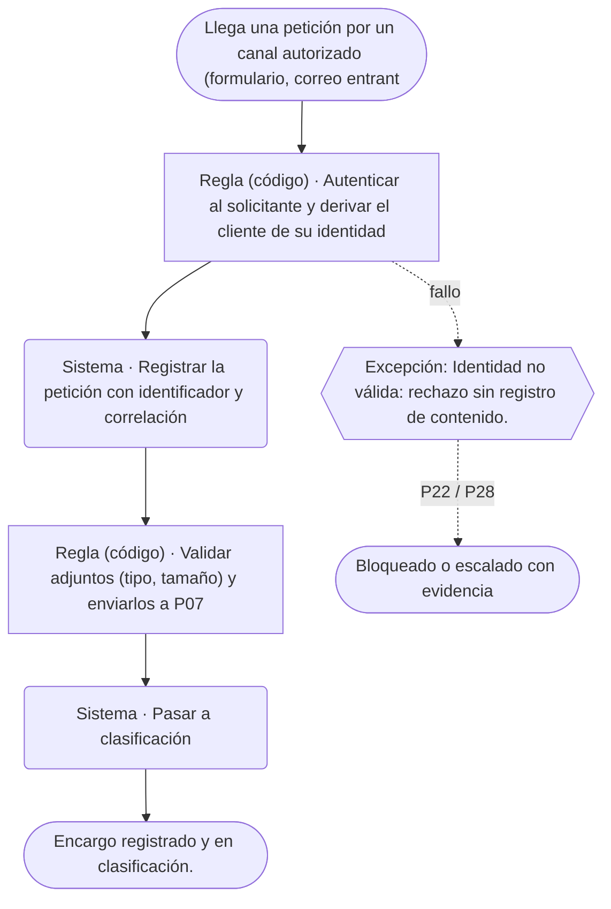

<!-- Generado por tools/org_gen.py desde tools/org_data/. No editar a mano. -->
# P01 · Alta y recepción de petición

**Origen:** Guía de Arranque v1.4 (Anexo I y II) · **Cuándo implantar:** MVP · **Estado de la ficha:** draft · **Implementado:** Parcial: estado RECIBIDO y auditoría en src/varios/procesos (sin API)

Leyenda: rectángulo, regla en código · paralelogramo, la IA propone · doble barra, persona · redondeado, sistema.

## 1. Descripción y objetivo
Registrar solicitante, cliente, objetivo, alcance, plazo, formato y restricciones.

## 2. Evento de inicio
Llega una petición por un canal autorizado (formulario, correo entrante, oficina).

## 3. Condiciones y datos de entrada
Texto de la petición, identidad autenticada del solicitante, adjuntos.

## 4. Actividades y tareas
1. Autenticar al solicitante y derivar el cliente de su identidad (Regla (código))
2. Registrar la petición con identificador y correlación (Sistema)
3. Validar adjuntos (tipo, tamaño) y enviarlos a P07 (Regla (código))
4. Pasar a clasificación (Sistema)

## 5. Responsables
Sistema; dueño del proceso: CEO digital

## 6. Departamentos y especialistas
- [CEO digital](../../knowledge/direccion/ceo-digital.md)

## 7. Decisiones y reglas
- El cliente sale de la identidad autenticada, nunca de la petición (D-005).
- Sin identidad válida, la petición no se registra.

## 8. Estados y transiciones
Encargo: Recibido → … → Cerrado (processes/definitions/encargo.json)

## 9. Entradas y salidas de cada tarea
| Tarea | Tipo | Salida |
|---|---|---|
| Autenticar al solicitante y derivar el cliente de su identidad | Regla (código) | tenant_id fiable |
| Registrar la petición con identificador y correlación | Sistema | Encargo en RECIBIDO |
| Validar adjuntos (tipo, tamaño) y enviarlos a P07 | Regla (código) | Referencias a documentos |
| Pasar a clasificación | Sistema | Encargo en EN_CLASIFICACION |

## 10. Sistemas y conectores
- API de entrada
- PostgreSQL

## 11. Permisos y controles
- Escritura de encargos del propio cliente

## 12. Excepciones y rutas alternativas
- Identidad no válida: rechazo sin registro de contenido.
- Adjunto no permitido: se registra el encargo sin él y se avisa.

## 13. Aprobaciones humanas
- Ninguna

## 14. Timeouts y reintentos
Timeout por tarea; máximo 3 intentos con espera exponencial y aleatoria solo para errores transitorios ([P22](P22-gestion-de-errores-y-reintentos.md))

## 15. Criterio de finalización
Encargo registrado y en clasificación.

## 16. Evidencias que se conservan
- Evento de auditoría con actor, cliente, fecha y correlación

## 17. KPI
- Tiempo de alta
- Peticiones rechazadas por identidad

## 18. Dependencias
- [P02](P02-clasificacion-y-triaje.md)
- [P07](P07-ingesta-documental.md)
- [P14](P14-gestion-de-permisos-y-aislamiento.md)

## 19. Precedentes y plantillas
- integrations/contracts/encargo.schema.json

## 20. Pruebas necesarias
- Petición con tenant_id en el cuerpo distinto del de la identidad: se ignora el del cuerpo.
- Sin autenticación: no se crea el encargo.

---
Especialistas: CEO digital. Definición original: Guía de Arranque v1.4 (Anexo I y II).
