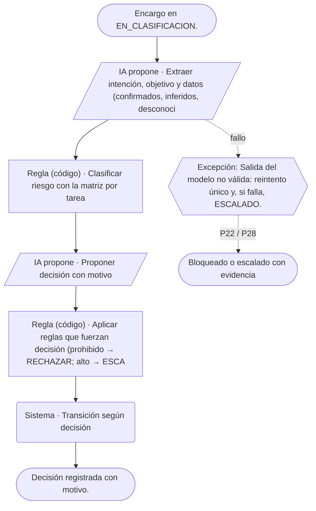

<!-- Generado por tools/org_gen.py desde tools/org_data/. No editar a mano. -->
# P02 · Clasificación y triaje

**Origen:** Guía de Arranque v1.4 (Anexo I y II) · **Cuándo implantar:** MVP · **Estado de la ficha:** draft · **Implementado:** No

Leyenda: rectángulo, regla en código · paralelogramo, la IA propone · doble barra, persona · redondeado, sistema.

## 1. Descripción y objetivo
Asignar sector, proceso, tipo de problema, complejidad, sensibilidad, riesgo e incertidumbre, y tomar una de las cinco decisiones.

## 2. Evento de inicio
Encargo en EN_CLASIFICACION.

## 3. Condiciones y datos de entrada
Encargo, conocimiento autorizado ([P04](P04-recuperacion-de-conocimiento.md)), catálogo de procesos.

## 4. Actividades y tareas
1. Extraer intención, objetivo y datos (confirmados, inferidos, desconocidos) (IA propone)
2. Clasificar riesgo con la matriz por tarea (Regla (código))
3. Proponer decisión con motivo (IA propone)
4. Aplicar reglas que fuerzan decisión (prohibido → RECHAZAR; alto → ESCALAR) (Regla (código))
5. Transición según decisión (Sistema)

## 5. Responsables
CEO digital

## 6. Departamentos y especialistas
- [CEO digital](../../knowledge/direccion/ceo-digital.md)
- [Especialistas sectoriales](../../knowledge/procesos/especialista-sectorial.md)

## 7. Decisiones y reglas
- La confianza del modelo no sustituye reglas ni aprobaciones.
- Ante duda entre dos niveles de riesgo, el más alto.
- Acciones externas, pagos, borrados y datos reales sin mandato: RECHAZAR.

## 8. Estados y transiciones
Encargo: Recibido → … → Cerrado (processes/definitions/encargo.json)

## 9. Entradas y salidas de cada tarea
| Tarea | Tipo | Salida |
|---|---|---|
| Extraer intención, objetivo y datos (confirmados, inferidos, desconocidos) | IA propone | Contrato de tarea propuesto |
| Clasificar riesgo con la matriz por tarea | Regla (código) | Nivel de riesgo |
| Proponer decisión con motivo | IA propone | Decisión propuesta |
| Aplicar reglas que fuerzan decisión (prohibido → RECHAZAR; alto → ESCALAR) | Regla (código) | Decisión final |
| Transición según decisión | Sistema | PENDIENTE_INFO, PLANIFICADO, ESCALADO o RECHAZADO |

## 10. Sistemas y conectores
- LLM vía adaptador
- Motor de procesos

## 11. Permisos y controles
- Lectura del conocimiento del cliente

## 12. Excepciones y rutas alternativas
- Salida del modelo no válida: reintento único y, si falla, ESCALADO.
- Contradicción entre reglas: ESCALADO.

## 13. Aprobaciones humanas
- ESCALADO: revisión de una persona identificada

## 14. Timeouts y reintentos
Timeout por tarea; máximo 3 intentos con espera exponencial y aleatoria solo para errores transitorios ([P22](P22-gestion-de-errores-y-reintentos.md))

## 15. Criterio de finalización
Decisión registrada con motivo.

## 16. Evidencias que se conservan
- Contrato de tarea
- Decisión, motivo, versión de instrucciones y modelo

## 17. KPI
- Acierto de clasificación frente a dataset etiquetado
- Escalados por mes

## 18. Dependencias
- [P01](P01-alta-y-recepcion-de-peticion.md)
- [P03](P03-gestion-de-aclaraciones.md)
- [P04](P04-recuperacion-de-conocimiento.md)
- [P05](P05-diseno-del-plan.md)
- [P19](P19-politica-de-uso-y-limites.md)

## 19. Precedentes y plantillas
- docs/14-reglas-del-ceo.md

## 20. Pruebas necesarias
- Encargo que pide enviar correos: RECHAZADO.
- Encargo con datos personales sensibles: riesgo alto y ESCALADO.

---
Especialistas: CEO digital, Especialistas sectoriales. Definición original: Guía de Arranque v1.4 (Anexo I y II).
