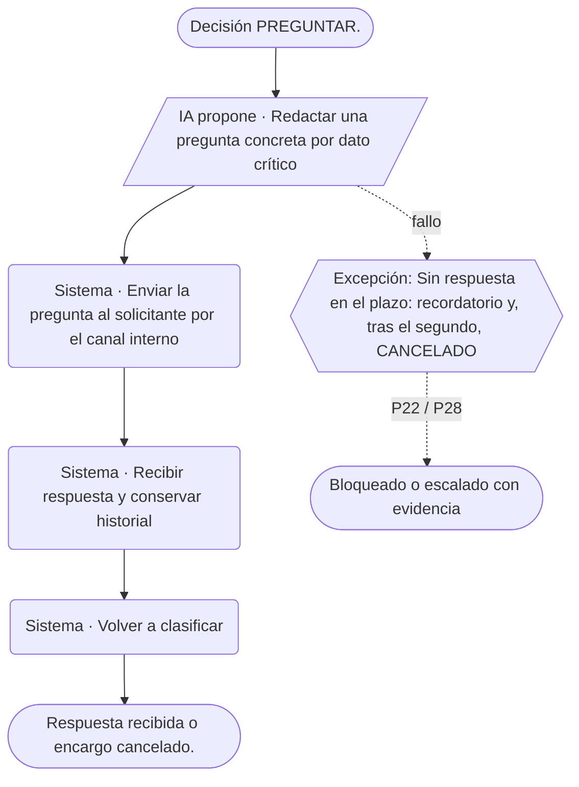

<!-- Generado por tools/org_gen.py desde tools/org_data/. No editar a mano. -->
# P03 · Gestión de aclaraciones

**Origen:** Guía de Arranque v1.4 (Anexo I y II) · **Cuándo implantar:** MVP · **Estado de la ficha:** draft · **Implementado:** No

Leyenda: rectángulo, regla en código · paralelogramo, la IA propone · doble barra, persona · redondeado, sistema.

## 1. Descripción y objetivo
Detectar datos ausentes, formular preguntas y bloquear las tareas que dependan de respuestas críticas.

## 2. Evento de inicio
Decisión PREGUNTAR.

## 3. Condiciones y datos de entrada
Datos desconocidos que cambian solución, coste o riesgo.

## 4. Actividades y tareas
1. Redactar una pregunta concreta por dato crítico (IA propone)
2. Enviar la pregunta al solicitante por el canal interno (Sistema)
3. Recibir respuesta y conservar historial (Sistema)
4. Volver a clasificar (Sistema)

## 5. Responsables
CEO digital

## 6. Departamentos y especialistas
- [CEO digital](../../knowledge/direccion/ceo-digital.md)

## 7. Decisiones y reglas
- Solo se reanuda al recibir respuesta.
- Se pregunta lo mínimo: una pregunta por dato que cambia la solución.

## 8. Estados y transiciones
Encargo: Recibido → … → Cerrado (processes/definitions/encargo.json)

## 9. Entradas y salidas de cada tarea
| Tarea | Tipo | Salida |
|---|---|---|
| Redactar una pregunta concreta por dato crítico | IA propone | Pregunta |
| Enviar la pregunta al solicitante por el canal interno | Sistema | Encargo en PENDIENTE_INFO |
| Recibir respuesta y conservar historial | Sistema | Respuesta registrada |
| Volver a clasificar | Sistema | EN_CLASIFICACION |

## 10. Sistemas y conectores
- Motor de procesos
- Canal de mensajes interno

## 11. Permisos y controles
- Comunicación con el solicitante del propio cliente

## 12. Excepciones y rutas alternativas
- Sin respuesta en el plazo: recordatorio y, tras el segundo, CANCELADO con aviso.

## 13. Aprobaciones humanas
- Ninguna

## 14. Timeouts y reintentos
Plazo de respuesta configurable por cliente (por definir en el contrato).

## 15. Criterio de finalización
Respuesta recibida o encargo cancelado.

## 16. Evidencias que se conservan
- Pregunta, respuesta y fechas

## 17. KPI
- Tiempo en PENDIENTE_INFO
- Encargos cancelados por falta de respuesta

## 18. Dependencias
- [P02](P02-clasificacion-y-triaje.md)

## 19. Precedentes y plantillas
Ninguna todavía.

## 20. Pruebas necesarias
- Respuesta recibida: el encargo vuelve a EN_CLASIFICACION, no salta a ejecución.

---
Especialistas: CEO digital. Definición original: Guía de Arranque v1.4 (Anexo I y II).
