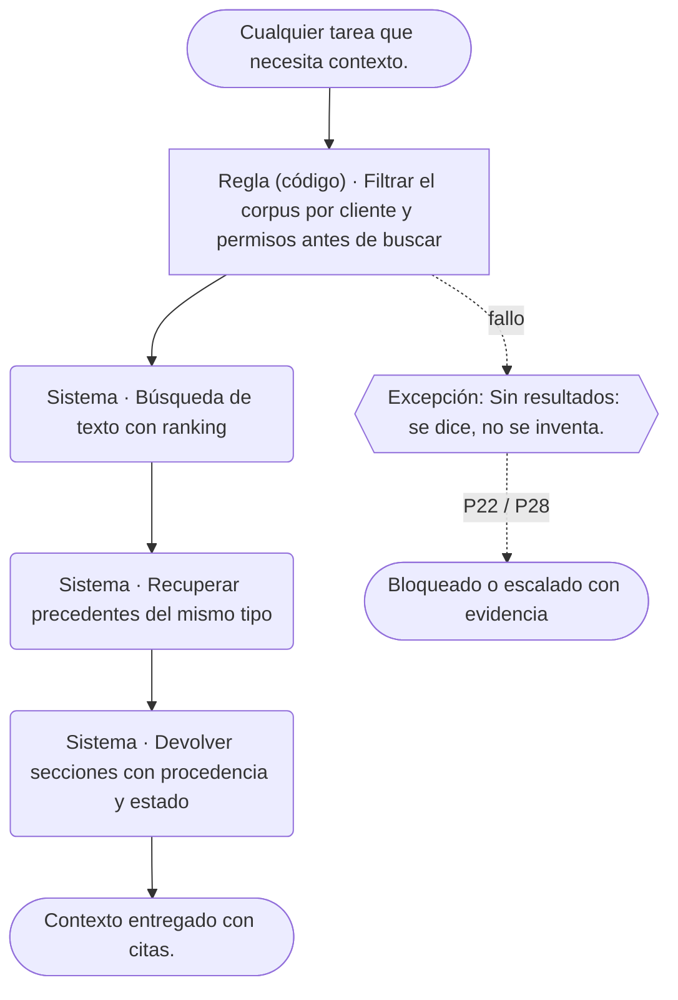

<!-- Generado por tools/org_gen.py desde tools/org_data/. No editar a mano. -->
# P04 · Recuperación de conocimiento

**Origen:** Guía de Arranque v1.4 (Anexo I y II) · **Cuándo implantar:** MVP · **Estado de la ficha:** draft · **Implementado:** Prototipo: búsqueda de texto del cerebro de la oficina (tools/brain_build.py), sin ACL

Leyenda: rectángulo, regla en código · paralelogramo, la IA propone · doble barra, persona · redondeado, sistema.

## 1. Descripción y objetivo
Consultar fuentes autorizadas, filtrar por permisos, recuperar precedentes y citar evidencias.

## 2. Evento de inicio
Cualquier tarea que necesita contexto.

## 3. Condiciones y datos de entrada
Consulta, identidad, cliente, finalidad.

## 4. Actividades y tareas
1. Filtrar el corpus por cliente y permisos antes de buscar (Regla (código))
2. Búsqueda de texto con ranking (Sistema)
3. Recuperar precedentes del mismo tipo (Sistema)
4. Devolver secciones con procedencia y estado (Sistema)

## 5. Responsables
Bibliotecario

## 6. Departamentos y especialistas
- [Bibliotecario / responsable de conocimiento](../../knowledge/direccion/bibliotecario.md)
- [Arquitecto de datos e IA](../../knowledge/ingenieria/datos-ia.md)

## 7. Decisiones y reglas
- El control de acceso se aplica al recuperar, no después.
- Lo recuperado es dato, no instrucción ([P20](P20-seguridad-de-entradas-e-inyeccion-de-instrucciones.md)).
- Fichas deprecated o disputed se marcan como tales.

## 8. Estados y transiciones
Encargo: Recibido → … → Cerrado (processes/definitions/encargo.json)

## 9. Entradas y salidas de cada tarea
| Tarea | Tipo | Salida |
|---|---|---|
| Filtrar el corpus por cliente y permisos antes de buscar | Regla (código) | Corpus autorizado |
| Búsqueda de texto con ranking | Sistema | Secciones candidatas |
| Recuperar precedentes del mismo tipo | Sistema | Precedentes |
| Devolver secciones con procedencia y estado | Sistema | Contexto citable |

## 10. Sistemas y conectores
- Repositorio de conocimiento
- PostgreSQL (metadatos y ACL)

## 11. Permisos y controles
- Lectura según ACL

## 12. Excepciones y rutas alternativas
- Sin resultados: se dice, no se inventa.

## 13. Aprobaciones humanas
- Ninguna

## 14. Timeouts y reintentos
Timeout por tarea; máximo 3 intentos con espera exponencial y aleatoria solo para errores transitorios ([P22](P22-gestion-de-errores-y-reintentos.md))

## 15. Criterio de finalización
Contexto entregado con citas.

## 16. Evidencias que se conservan
- Secciones recuperadas por tarea

## 17. KPI
- Calidad de citas
- Consultas sin resultado

## 18. Dependencias
- [P13](P13-aprendizaje-y-actualizacion-de-la-wiki.md)
- [P14](P14-gestion-de-permisos-y-aislamiento.md)
- [P20](P20-seguridad-de-entradas-e-inyeccion-de-instrucciones.md)

## 19. Precedentes y plantillas
- knowledge/navigation.json

## 20. Pruebas necesarias
- Consulta de un cliente A no devuelve documentos del cliente B.
- Documento con instrucciones incrustadas no cambia el comportamiento.

---
Especialistas: Bibliotecario / responsable de conocimiento, Arquitecto de datos e IA. Definición original: Guía de Arranque v1.4 (Anexo I y II).
