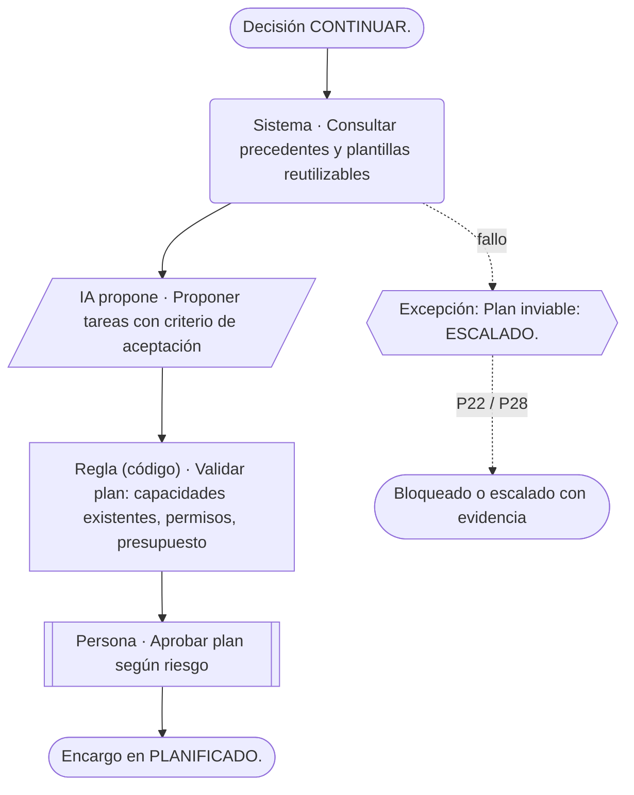

<!-- Generado por tools/org_gen.py desde tools/org_data/. No editar a mano. -->
# P05 · Diseño del plan

**Origen:** Guía de Arranque v1.4 (Anexo I y II) · **Cuándo implantar:** MVP · **Estado de la ficha:** draft · **Implementado:** No

Leyenda: rectángulo, regla en código · paralelogramo, la IA propone · doble barra, persona · redondeado, sistema.

## 1. Descripción y objetivo
Descomponer el objetivo en tareas, dependencias, responsables, herramientas y criterios de aceptación.

## 2. Evento de inicio
Decisión CONTINUAR.

## 3. Condiciones y datos de entrada
Contrato de tarea, catálogo de capacidades, precedentes.

## 4. Actividades y tareas
1. Consultar precedentes y plantillas reutilizables (Sistema)
2. Proponer tareas con criterio de aceptación (IA propone)
3. Validar plan: capacidades existentes, permisos, presupuesto (Regla (código))
4. Aprobar plan según riesgo (Persona)

## 5. Responsables
CEO digital

## 6. Departamentos y especialistas
- [CEO digital](../../knowledge/direccion/ceo-digital.md)
- [Responsable de decisiones y seguimiento](../../knowledge/direccion/decisiones-seguimiento.md)

## 7. Decisiones y reglas
- Toda tarea tiene criterio de aceptación verificable.
- Solo capacidades en estado approved.

## 8. Estados y transiciones
Encargo: Recibido → … → Cerrado (processes/definitions/encargo.json)

## 9. Entradas y salidas de cada tarea
| Tarea | Tipo | Salida |
|---|---|---|
| Consultar precedentes y plantillas reutilizables | Sistema | Lista de reutilizables |
| Proponer tareas con criterio de aceptación | IA propone | Plan propuesto |
| Validar plan: capacidades existentes, permisos, presupuesto | Regla (código) | Plan válido o errores |
| Aprobar plan según riesgo | Persona | Plan aprobado |

## 10. Sistemas y conectores
- Motor de procesos

## 11. Permisos y controles
- Crear tareas

## 12. Excepciones y rutas alternativas
- Plan inviable: ESCALADO.

## 13. Aprobaciones humanas
- Riesgo medio o alto: aprobación del plan

## 14. Timeouts y reintentos
Timeout por tarea; máximo 3 intentos con espera exponencial y aleatoria solo para errores transitorios ([P22](P22-gestion-de-errores-y-reintentos.md))

## 15. Criterio de finalización
Encargo en PLANIFICADO.

## 16. Evidencias que se conservan
- Plan versionado

## 17. KPI
- Planes reutilizando precedentes / total

## 18. Dependencias
- [P02](P02-clasificacion-y-triaje.md)
- [P04](P04-recuperacion-de-conocimiento.md)
- [P06](P06-asignacion-y-coordinacion.md)

## 19. Precedentes y plantillas
Ninguna todavía.

## 20. Pruebas necesarias
- Plan con tarea sin criterio: rechazado por validación.

---
Especialistas: CEO digital, Responsable de decisiones y seguimiento. Definición original: Guía de Arranque v1.4 (Anexo I y II).
