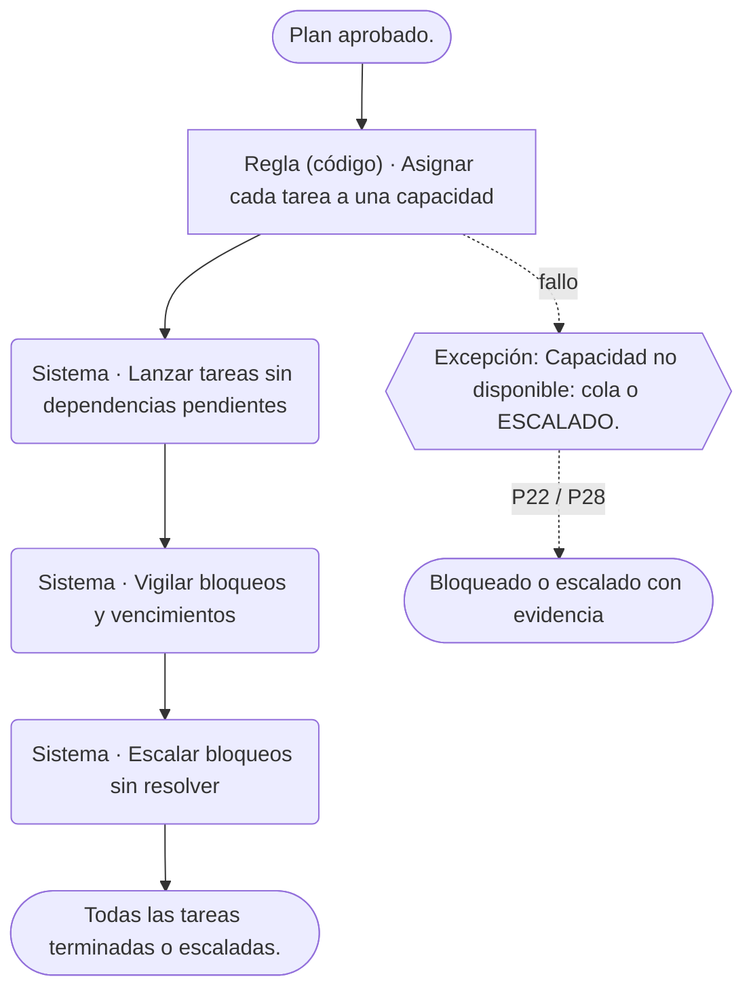

<!-- Generado por tools/org_gen.py desde tools/org_data/. No editar a mano. -->
# P06 · Asignación y coordinación

**Origen:** Guía de Arranque v1.4 (Anexo I y II) · **Cuándo implantar:** MVP · **Estado de la ficha:** draft · **Implementado:** No

Leyenda: rectángulo, regla en código · paralelogramo, la IA propone · doble barra, persona · redondeado, sistema.

## 1. Descripción y objetivo
Seleccionar departamentos y especialistas; controlar carga, estados, bloqueos y escalados.

## 2. Evento de inicio
Plan aprobado.

## 3. Condiciones y datos de entrada
Plan, disponibilidad de capacidades.

## 4. Actividades y tareas
1. Asignar cada tarea a una capacidad (Regla (código))
2. Lanzar tareas sin dependencias pendientes (Sistema)
3. Vigilar bloqueos y vencimientos (Sistema)
4. Escalar bloqueos sin resolver (Sistema)

## 5. Responsables
CEO digital y motor de procesos

## 6. Departamentos y especialistas
- [CEO digital](../../knowledge/direccion/ceo-digital.md)

## 7. Decisiones y reglas
- Una tarea no empieza con dependencias abiertas.
- Límite de concurrencia por cliente ([P29](P29-gestion-de-costes-y-capacidad.md)).

## 8. Estados y transiciones
Encargo: Recibido → … → Cerrado (processes/definitions/encargo.json)

## 9. Entradas y salidas de cada tarea
| Tarea | Tipo | Salida |
|---|---|---|
| Asignar cada tarea a una capacidad | Regla (código) | Tareas asignadas |
| Lanzar tareas sin dependencias pendientes | Sistema | Tareas en running |
| Vigilar bloqueos y vencimientos | Sistema | Alertas |
| Escalar bloqueos sin resolver | Sistema | ESCALADO |

## 10. Sistemas y conectores
- Motor de procesos

## 11. Permisos y controles
- Asignar tareas

## 12. Excepciones y rutas alternativas
- Capacidad no disponible: cola o ESCALADO.

## 13. Aprobaciones humanas
Según la matriz de riesgo (docs/14).

## 14. Timeouts y reintentos
Timeout por tarea; máximo 3 intentos con espera exponencial y aleatoria solo para errores transitorios ([P22](P22-gestion-de-errores-y-reintentos.md))

## 15. Criterio de finalización
Todas las tareas terminadas o escaladas.

## 16. Evidencias que se conservan
- Historial de asignaciones

## 17. KPI
- Tiempo en cola
- Bloqueos por semana

## 18. Dependencias
- [P05](P05-diseno-del-plan.md)
- [P08](P08-ejecucion-de-tareas.md)
- [P29](P29-gestion-de-costes-y-capacidad.md)

## 19. Precedentes y plantillas
Ninguna todavía.

## 20. Pruebas necesarias
- Tarea con dependencia abierta no arranca.

---
Especialistas: CEO digital. Definición original: Guía de Arranque v1.4 (Anexo I y II).
