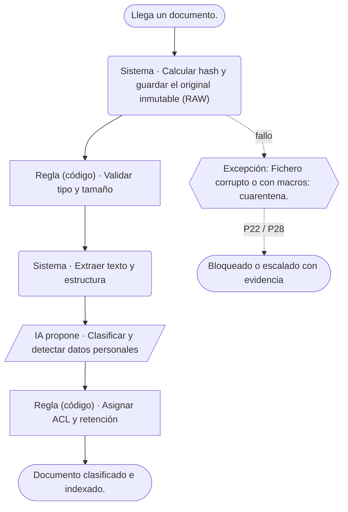

<!-- Generado por tools/org_gen.py desde tools/org_data/. No editar a mano. -->
# P07 · Ingesta documental

**Origen:** Guía de Arranque v1.4 (Anexo I y II) · **Cuándo implantar:** Antes de datos reales · **Estado de la ficha:** draft · **Implementado:** No

Leyenda: rectángulo, regla en código · paralelogramo, la IA propone · doble barra, persona · redondeado, sistema.

## 1. Descripción y objetivo
Validar tipo, origen, integridad, metadatos, clasificación, permisos y versión; conservar el original.

## 2. Evento de inicio
Llega un documento.

## 3. Condiciones y datos de entrada
Fichero, origen, cliente.

## 4. Actividades y tareas
1. Calcular hash y guardar el original inmutable (RAW) (Sistema)
2. Validar tipo y tamaño (Regla (código))
3. Extraer texto y estructura (Sistema)
4. Clasificar y detectar datos personales (IA propone)
5. Asignar ACL y retención (Regla (código))

## 5. Responsables
Bibliotecario

## 6. Departamentos y especialistas
- [Bibliotecario / responsable de conocimiento](../../knowledge/direccion/bibliotecario.md)
- [Arquitecto de datos e IA](../../knowledge/ingenieria/datos-ia.md)
- [Especialista legal y privacidad](../../knowledge/seguridad-legal/legal-privacidad.md)

## 7. Decisiones y reglas
- El original no se modifica.
- Sin clasificación, no entra en el índice.

## 8. Estados y transiciones
Encargo: Recibido → … → Cerrado (processes/definitions/encargo.json)

## 9. Entradas y salidas de cada tarea
| Tarea | Tipo | Salida |
|---|---|---|
| Calcular hash y guardar el original inmutable (RAW) | Sistema | Original con hash |
| Validar tipo y tamaño | Regla (código) | Aceptado o rechazado |
| Extraer texto y estructura | Sistema | Texto extraído (Docling, en evaluación) |
| Clasificar y detectar datos personales | IA propone | Clasificación propuesta |
| Asignar ACL y retención | Regla (código) | Metadatos completos |

## 10. Sistemas y conectores
- Almacenamiento de objetos
- PostgreSQL

## 11. Permisos y controles
- Escritura RAW del cliente

## 12. Excepciones y rutas alternativas
- Fichero corrupto o con macros: cuarentena.

## 13. Aprobaciones humanas
- Datos especialmente protegidos: revisión

## 14. Timeouts y reintentos
Timeout por tarea; máximo 3 intentos con espera exponencial y aleatoria solo para errores transitorios ([P22](P22-gestion-de-errores-y-reintentos.md))

## 15. Criterio de finalización
Documento clasificado e indexado.

## 16. Evidencias que se conservan
- Hash, origen, versión, clasificación

## 17. KPI
- Documentos en cuarentena
- Exactitud de clasificación

## 18. Dependencias
- [P14](P14-gestion-de-permisos-y-aislamiento.md)
- [P20](P20-seguridad-de-entradas-e-inyeccion-de-instrucciones.md)
- [P24](P24-gestion-del-ciclo-de-vida-del-dato.md)

## 19. Precedentes y plantillas
Ninguna todavía.

## 20. Pruebas necesarias
- Mismo fichero dos veces: un solo original (idempotencia por hash).

---
Especialistas: Bibliotecario / responsable de conocimiento, Arquitecto de datos e IA, Especialista legal y privacidad. Definición original: Guía de Arranque v1.4 (Anexo I y II).
