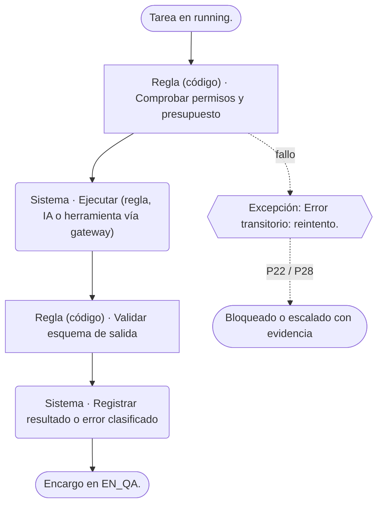

<!-- Generado por tools/org_gen.py desde tools/org_data/. No editar a mano. -->
# P08 · Ejecución de tareas

**Origen:** Guía de Arranque v1.4 (Anexo I y II) · **Cuándo implantar:** MVP · **Estado de la ficha:** draft · **Implementado:** Parcial: política de reintentos e idempotencia en src/varios/procesos/reintentos.py

Leyenda: rectángulo, regla en código · paralelogramo, la IA propone · doble barra, persona · redondeado, sistema.

## 1. Descripción y objetivo
Ejecutar análisis, reglas, código o automatizaciones con límites, registro y tratamiento de errores.

## 2. Evento de inicio
Tarea en running.

## 3. Condiciones y datos de entrada
Tarea con entradas tipadas.

## 4. Actividades y tareas
1. Comprobar permisos y presupuesto (Regla (código))
2. Ejecutar (regla, IA o herramienta vía gateway) (Sistema)
3. Validar esquema de salida (Regla (código))
4. Registrar resultado o error clasificado (Sistema)

## 5. Responsables
Capacidad asignada

## 6. Departamentos y especialistas
- [Especialista backend](../../knowledge/ingenieria/backend.md)
- [Especialista en automatización](../../knowledge/procesos/automatizacion.md)

## 7. Decisiones y reglas
- Herramientas solo vía gateway con lista cerrada.
- Reintentos según [P22](P22-gestion-de-errores-y-reintentos.md).

## 8. Estados y transiciones
Encargo: Recibido → … → Cerrado (processes/definitions/encargo.json)

## 9. Entradas y salidas de cada tarea
| Tarea | Tipo | Salida |
|---|---|---|
| Comprobar permisos y presupuesto | Regla (código) | Autorización |
| Ejecutar (regla, IA o herramienta vía gateway) | Sistema | Salida tipada |
| Validar esquema de salida | Regla (código) | Salida válida |
| Registrar resultado o error clasificado | Sistema | Evento de auditoría |

## 10. Sistemas y conectores
- Motor de procesos
- Gateway de herramientas

## 11. Permisos y controles
- Los de la tarea, mínimos

## 12. Excepciones y rutas alternativas
- Error transitorio: reintento.
- Autorización o seguridad: BLOQUEADO sin reintento.

## 13. Aprobaciones humanas
Según la matriz de riesgo (docs/14).

## 14. Timeouts y reintentos
Timeout por tarea; máximo 3 intentos con espera exponencial y aleatoria solo para errores transitorios ([P22](P22-gestion-de-errores-y-reintentos.md))

## 15. Criterio de finalización
Encargo en EN_QA.

## 16. Evidencias que se conservan
- Entradas, salida, duración, coste

## 17. KPI
- Errores por tipo
- Coste por tarea

## 18. Dependencias
- [P21](P21-ejecucion-segura-de-herramientas.md)
- [P22](P22-gestion-de-errores-y-reintentos.md)
- [P29](P29-gestion-de-costes-y-capacidad.md)

## 19. Precedentes y plantillas
Ninguna todavía.

## 20. Pruebas necesarias
- Error de permisos no se reintenta.
- Salida que no cumple el esquema no avanza.

---
Especialistas: Especialista backend, Especialista en automatización. Definición original: Guía de Arranque v1.4 (Anexo I y II).
