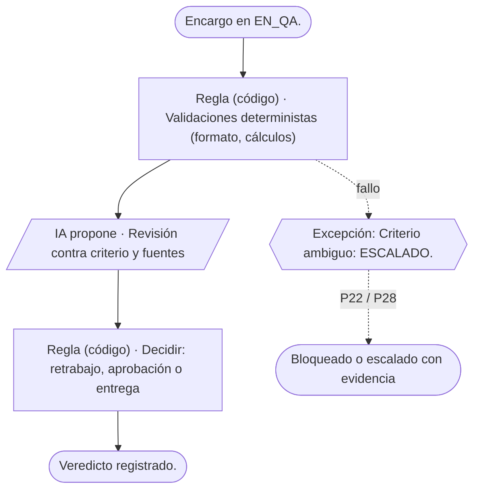

<!-- Generado por tools/org_gen.py desde tools/org_data/. No editar a mano. -->
# P09 · Control de calidad

**Origen:** Guía de Arranque v1.4 (Anexo I y II) · **Cuándo implantar:** MVP · **Estado de la ficha:** draft · **Implementado:** Prototipo en la oficina de agentes (revisión por el agente de Calidad)

Leyenda: rectángulo, regla en código · paralelogramo, la IA propone · doble barra, persona · redondeado, sistema.

## 1. Descripción y objetivo
Comprobar formato, completitud, coherencia, cálculos, fuentes, pruebas y criterios del encargo.

## 2. Evento de inicio
Encargo en EN_QA.

## 3. Condiciones y datos de entrada
Entregable y criterio de aceptación.

## 4. Actividades y tareas
1. Validaciones deterministas (formato, cálculos) (Regla (código))
2. Revisión contra criterio y fuentes (IA propone)
3. Decidir: retrabajo, aprobación o entrega (Regla (código))

## 5. Responsables
Calidad

## 6. Departamentos y especialistas
- [Especialista en calidad y riesgos](../../knowledge/seguridad-legal/calidad-riesgos.md)
- [Especialista en evaluación de IA](../../knowledge/ingenieria/evaluacion-ia.md)

## 7. Decisiones y reglas
- QA no aprueba lo que no ha comprobado.
- Quien hizo la tarea no hace su QA.
- Un retrabajo automático como máximo; después, persona.

## 8. Estados y transiciones
Encargo: Recibido → … → Cerrado (processes/definitions/encargo.json)

## 9. Entradas y salidas de cada tarea
| Tarea | Tipo | Salida |
|---|---|---|
| Validaciones deterministas (formato, cálculos) | Regla (código) | Resultado por regla |
| Revisión contra criterio y fuentes | IA propone | Veredicto con problemas |
| Decidir: retrabajo, aprobación o entrega | Regla (código) | RETRABAJO, PENDIENTE_APROBACION o ENTREGADO |

## 10. Sistemas y conectores
- Suite de validaciones

## 11. Permisos y controles
- Lectura del entregable

## 12. Excepciones y rutas alternativas
- Criterio ambiguo: ESCALADO.

## 13. Aprobaciones humanas
- Riesgo medio o alto, o QA con problemas: [P10](P10-aprobacion-humana.md)

## 14. Timeouts y reintentos
Timeout por tarea; máximo 3 intentos con espera exponencial y aleatoria solo para errores transitorios ([P22](P22-gestion-de-errores-y-reintentos.md))

## 15. Criterio de finalización
Veredicto registrado.

## 16. Evidencias que se conservan
- Resultado de cada validación

## 17. KPI
- First-pass yield
- Retrabajos

## 18. Dependencias
- [P08](P08-ejecucion-de-tareas.md)
- [P10](P10-aprobacion-humana.md)
- [P23](P23-evaluacion-de-agentes-y-modelos.md)

## 19. Precedentes y plantillas
Ninguna todavía.

## 20. Pruebas necesarias
- Entregable que no cumple el criterio pasa a RETRABAJO.
- Paso directo a ENTREGADO solo con riesgo bajo y QA conforme.

---
Especialistas: Especialista en calidad y riesgos, Especialista en evaluación de IA. Definición original: Guía de Arranque v1.4 (Anexo I y II).
