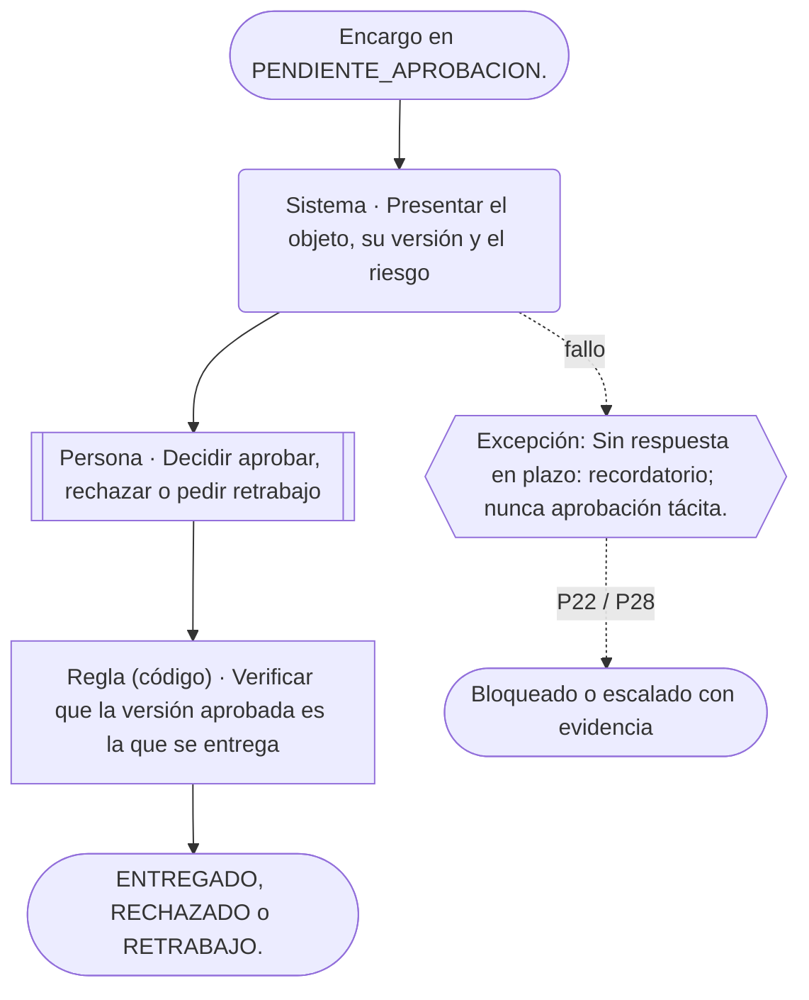

<!-- Generado por tools/org_gen.py desde tools/org_data/. No editar a mano. -->
# P10 · Aprobación humana

**Origen:** Guía de Arranque v1.4 (Anexo I y II) · **Cuándo implantar:** MVP · **Estado de la ficha:** draft · **Implementado:** Sí, como regla del motor: src/varios/procesos/motor.py

Leyenda: rectángulo, regla en código · paralelogramo, la IA propone · doble barra, persona · redondeado, sistema.

## 1. Descripción y objetivo
Solicitar aprobación para decisiones sensibles, acciones externas, entregas reguladas o tareas de alto impacto.

## 2. Evento de inicio
Encargo en PENDIENTE_APROBACION.

## 3. Condiciones y datos de entrada
Objeto exacto a aprobar y su versión.

## 4. Actividades y tareas
1. Presentar el objeto, su versión y el riesgo (Sistema)
2. Decidir aprobar, rechazar o pedir retrabajo (Persona)
3. Verificar que la versión aprobada es la que se entrega (Regla (código))

## 5. Responsables
Socio o aprobador autorizado

## 6. Departamentos y especialistas
- [CEO digital](../../knowledge/direccion/ceo-digital.md)
- [Especialista en calidad y riesgos](../../knowledge/seguridad-legal/calidad-riesgos.md)

## 7. Decisiones y reglas
- Aprobación ligada a la versión exacta: si cambia, se aprueba de nuevo.
- Nadie aprueba su propia acción.
- Doble aprobación si el riesgo o el contrato lo exigen.

## 8. Estados y transiciones
Encargo: Recibido → … → Cerrado (processes/definitions/encargo.json)

## 9. Entradas y salidas de cada tarea
| Tarea | Tipo | Salida |
|---|---|---|
| Presentar el objeto, su versión y el riesgo | Sistema | Solicitud |
| Decidir aprobar, rechazar o pedir retrabajo | Persona | Decisión |
| Verificar que la versión aprobada es la que se entrega | Regla (código) | Coincidencia de versión |

## 10. Sistemas y conectores
- Motor de procesos

## 11. Permisos y controles
- Rol de aprobador

## 12. Excepciones y rutas alternativas
- Sin respuesta en plazo: recordatorio; nunca aprobación tácita.

## 13. Aprobaciones humanas
- Es el propio proceso

## 14. Timeouts y reintentos
Timeout por tarea; máximo 3 intentos con espera exponencial y aleatoria solo para errores transitorios ([P22](P22-gestion-de-errores-y-reintentos.md))

## 15. Criterio de finalización
ENTREGADO, RECHAZADO o RETRABAJO.

## 16. Evidencias que se conservan
- Aprobador, rol, fecha, versión, decisión y motivo

## 17. KPI
- Tiempo de aprobación
- Rechazos

## 18. Dependencias
- [P09](P09-control-de-calidad.md)
- [P11](P11-entrega-y-cierre.md)

## 19. Precedentes y plantillas
Ninguna todavía.

## 20. Pruebas necesarias
- El mismo actor que produjo no puede aprobar.
- Aprobación de una versión distinta: rechazada.

---
Especialistas: CEO digital, Especialista en calidad y riesgos. Definición original: Guía de Arranque v1.4 (Anexo I y II).
