<!-- Generado por tools/org_gen.py desde tools/org_data/. No editar a mano. -->
# P11 · Entrega y cierre

**Origen:** Guía de Arranque v1.4 (Anexo I y II) · **Cuándo implantar:** MVP · **Estado de la ficha:** draft · **Implementado:** No

```mermaid
flowchart TD
  S(["Encargo ENTREGADO."])
  A0("Sistema · Entregar con limitaciones y fuentes")
  S --> A0
  A1[["Persona · Registrar aceptación del solicitante"]]
  A0 --> A1
  A2[/"IA propone · Proponer precedente y lecciones (P13)"/]
  A1 --> A2
  A3("Sistema · Cerrar")
  A2 --> A3
  F(["Encargo CERRADO con precedente propuesto."])
  A3 --> F
  X{{"Excepción: Rechazo del solicitante: REABIERTO."}}
  A0 -. fallo .-> X
  X -. "P22 / P28" .-> E(["Bloqueado o escalado con evidencia"])
```

Leyenda: rectángulo, regla en código · paralelogramo, la IA propone · doble barra, persona · redondeado, sistema.

## 1. Descripción y objetivo
Entregar artefactos, evidencias, limitaciones, métricas, aceptación y registro de cierre.

## 2. Evento de inicio
Encargo ENTREGADO.

## 3. Condiciones y datos de entrada
Entregable aprobado.

## 4. Actividades y tareas
1. Entregar con limitaciones y fuentes (Sistema)
2. Registrar aceptación del solicitante (Persona)
3. Proponer precedente y lecciones (P13) (IA propone)
4. Cerrar (Sistema)

## 5. Responsables
CEO digital

## 6. Departamentos y especialistas
- [CEO digital](../../knowledge/direccion/ceo-digital.md)
- [Bibliotecario / responsable de conocimiento](../../knowledge/direccion/bibliotecario.md)

## 7. Decisiones y reglas
- Cerrado solo se reabre con motivo, autorización y nueva versión.

## 8. Estados y transiciones
Encargo: Recibido → … → Cerrado (processes/definitions/encargo.json)

## 9. Entradas y salidas de cada tarea
| Tarea | Tipo | Salida |
|---|---|---|
| Entregar con limitaciones y fuentes | Sistema | Entrega |
| Registrar aceptación del solicitante | Persona | Aceptación |
| Proponer precedente y lecciones (P13) | IA propone | Borrador de precedente |
| Cerrar | Sistema | CERRADO |

## 10. Sistemas y conectores
- Motor de procesos

## 11. Permisos y controles
- Lectura del entregable

## 12. Excepciones y rutas alternativas
- Rechazo del solicitante: REABIERTO.

## 13. Aprobaciones humanas
Según la matriz de riesgo (docs/14).

## 14. Timeouts y reintentos
Timeout por tarea; máximo 3 intentos con espera exponencial y aleatoria solo para errores transitorios ([P22](P22-gestion-de-errores-y-reintentos.md))

## 15. Criterio de finalización
Encargo CERRADO con precedente propuesto.

## 16. Evidencias que se conservan
- Entrega, aceptación, métricas

## 17. KPI
- Encargos reabiertos
- Tiempo total

## 18. Dependencias
- [P10](P10-aprobacion-humana.md)
- [P13](P13-aprendizaje-y-actualizacion-de-la-wiki.md)
- [P18](P18-evaluacion-y-mejora.md)

## 19. Precedentes y plantillas
- precedents/plantilla-precedente.md

## 20. Pruebas necesarias
- CERRADO → REABIERTO sin motivo: rechazado.

---
Especialistas: CEO digital, Bibliotecario / responsable de conocimiento. Definición original: Guía de Arranque v1.4 (Anexo I y II).
