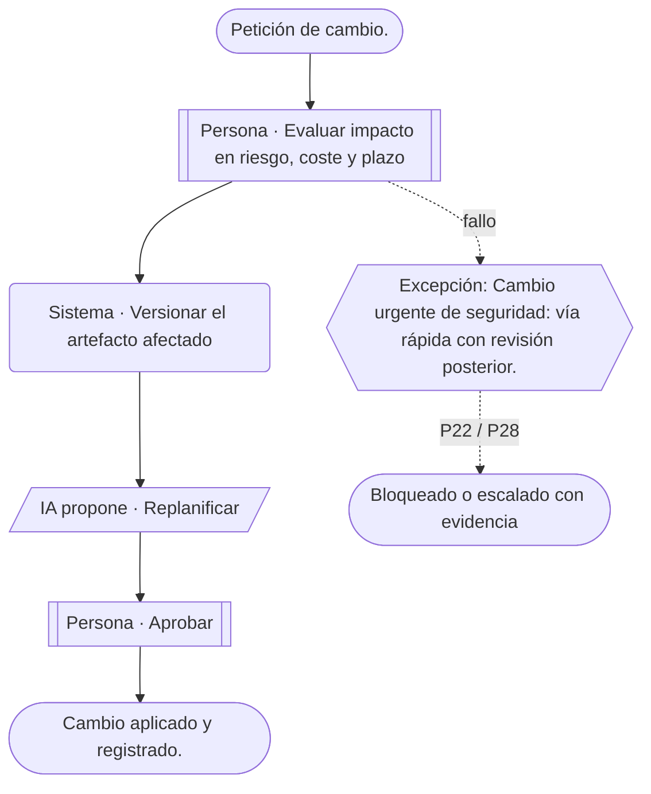

<!-- Generado por tools/org_gen.py desde tools/org_data/. No editar a mano. -->
# P12 · Gestión de cambios

**Origen:** Guía de Arranque v1.4 (Anexo I y II) · **Cuándo implantar:** Antes de escalar · **Estado de la ficha:** draft · **Implementado:** No

Leyenda: rectángulo, regla en código · paralelogramo, la IA propone · doble barra, persona · redondeado, sistema.

## 1. Descripción y objetivo
Evaluar cambios de alcance, datos, modelo, reglas o herramientas; versionar y replanificar.

## 2. Evento de inicio
Petición de cambio.

## 3. Condiciones y datos de entrada
Cambio propuesto e impacto.

## 4. Actividades y tareas
1. Evaluar impacto en riesgo, coste y plazo (Persona)
2. Versionar el artefacto afectado (Sistema)
3. Replanificar (IA propone)
4. Aprobar (Persona)

## 5. Responsables
Responsable de decisiones

## 6. Departamentos y especialistas
- [Responsable de decisiones y seguimiento](../../knowledge/direccion/decisiones-seguimiento.md)
- [Responsable de implantación de clientes](../../knowledge/procesos/implantacion-clientes.md)

## 7. Decisiones y reglas
- Un cambio de finalidad reabre la evaluación de riesgo y privacidad.

## 8. Estados y transiciones
Definición de proceso: draft → under_review → approved → active → deprecated → retired

## 9. Entradas y salidas de cada tarea
| Tarea | Tipo | Salida |
|---|---|---|
| Evaluar impacto en riesgo, coste y plazo | Persona | Análisis de impacto |
| Versionar el artefacto afectado | Sistema | Nueva versión |
| Replanificar | IA propone | Plan revisado |
| Aprobar | Persona | Cambio aprobado |

## 10. Sistemas y conectores
Motor de procesos y PostgreSQL (por defecto).

## 11. Permisos y controles
Mínimos para la tarea; cliente derivado de la identidad.

## 12. Excepciones y rutas alternativas
- Cambio urgente de seguridad: vía rápida con revisión posterior.

## 13. Aprobaciones humanas
- Socios o cliente según alcance

## 14. Timeouts y reintentos
Timeout por tarea; máximo 3 intentos con espera exponencial y aleatoria solo para errores transitorios ([P22](P22-gestion-de-errores-y-reintentos.md))

## 15. Criterio de finalización
Cambio aplicado y registrado.

## 16. Evidencias que se conservan
- Petición, análisis, aprobación

## 17. KPI
- Cambios no planificados

## 18. Dependencias
- [P25](P25-gestion-de-cambios-y-versiones.md)
- [P34](P34-gestion-de-definiciones-de-proceso.md)

## 19. Precedentes y plantillas
Ninguna todavía.

## 20. Pruebas necesarias
- Instancia en curso conserva su versión salvo migración explícita.

---
Especialistas: Responsable de decisiones y seguimiento, Responsable de implantación de clientes. Definición original: Guía de Arranque v1.4 (Anexo I y II).
