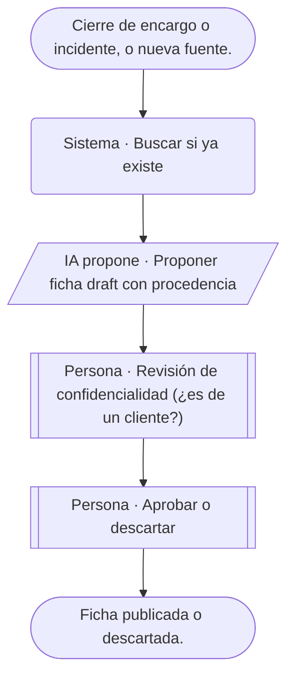

<!-- Generado por tools/org_gen.py desde tools/org_data/. No editar a mano. -->
# P13 · Aprendizaje y actualización de la wiki

**Origen:** Guía de Arranque v1.4 (Anexo I y II) · **Cuándo implantar:** Antes de escalar · **Estado de la ficha:** draft · **Implementado:** No

Leyenda: rectángulo, regla en código · paralelogramo, la IA propone · doble barra, persona · redondeado, sistema.

## 1. Descripción y objetivo
Proponer, revisar, aprobar, versionar y retirar conocimiento derivado de proyectos.

## 2. Evento de inicio
Cierre de encargo o incidente, o nueva fuente.

## 3. Condiciones y datos de entrada
Precedente o hallazgo.

## 4. Actividades y tareas
1. Buscar si ya existe (Sistema)
2. Proponer ficha draft con procedencia (IA propone)
3. Revisión de confidencialidad (¿es de un cliente?) (Persona)
4. Aprobar o descartar (Persona)

## 5. Responsables
Bibliotecario

## 6. Departamentos y especialistas
- [Bibliotecario / responsable de conocimiento](../../knowledge/direccion/bibliotecario.md)

## 7. Decisiones y reglas
- Nada pasa a approved sin revisión.
- Información de un cliente no pasa a lo común sin autorización.

## 8. Estados y transiciones
Ficha: raw → draft → validated → approved → deprecated / disputed

## 9. Entradas y salidas de cada tarea
| Tarea | Tipo | Salida |
|---|---|---|
| Buscar si ya existe | Sistema | Coincidencias |
| Proponer ficha draft con procedencia | IA propone | Ficha draft |
| Revisión de confidencialidad (¿es de un cliente?) | Persona | Apta o no para lo común |
| Aprobar o descartar | Persona | approved o descartada |

## 10. Sistemas y conectores
Motor de procesos y PostgreSQL (por defecto).

## 11. Permisos y controles
Mínimos para la tarea; cliente derivado de la identidad.

## 12. Excepciones y rutas alternativas
Errores según P22; incidentes según P28.

## 13. Aprobaciones humanas
- Socio o responsable del área

## 14. Timeouts y reintentos
Timeout por tarea; máximo 3 intentos con espera exponencial y aleatoria solo para errores transitorios ([P22](P22-gestion-de-errores-y-reintentos.md))

## 15. Criterio de finalización
Ficha publicada o descartada.

## 16. Evidencias que se conservan
- Historial Git de la ficha

## 17. KPI
- Fichas draft con más de 30 días

## 18. Dependencias
- [P04](P04-recuperacion-de-conocimiento.md)
- [P11](P11-entrega-y-cierre.md)
- [P28](P28-gestion-de-incidentes.md)

## 19. Precedentes y plantillas
- knowledge/plantillas/ficha-conocimiento.md

## 20. Pruebas necesarias
- Ficha sin fuente: no puede pasar de draft.

---
Especialistas: Bibliotecario / responsable de conocimiento. Definición original: Guía de Arranque v1.4 (Anexo I y II).
