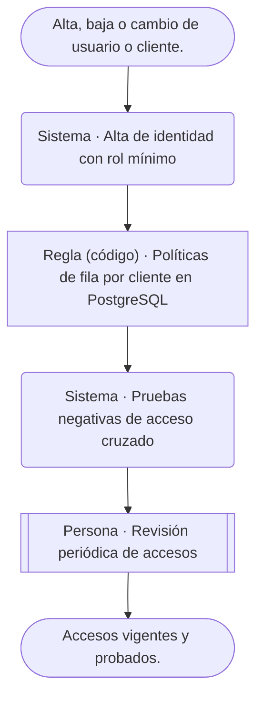

<!-- Generado por tools/org_gen.py desde tools/org_data/. No editar a mano. -->
# P14 · Gestión de permisos y aislamiento

**Origen:** Guía de Arranque v1.4 (Anexo I y II) · **Cuándo implantar:** Antes de datos reales · **Estado de la ficha:** draft · **Implementado:** No

Leyenda: rectángulo, regla en código · paralelogramo, la IA propone · doble barra, persona · redondeado, sistema.

## 1. Descripción y objetivo
Administrar identidades, roles, cliente, ámbitos de acceso y pruebas de segregación.

## 2. Evento de inicio
Alta, baja o cambio de usuario o cliente.

## 3. Condiciones y datos de entrada
Identidad, rol, cliente.

## 4. Actividades y tareas
1. Alta de identidad con rol mínimo (Sistema)
2. Políticas de fila por cliente en PostgreSQL (Regla (código))
3. Pruebas negativas de acceso cruzado (Sistema)
4. Revisión periódica de accesos (Persona)

## 5. Responsables
Ciberseguridad

## 6. Departamentos y especialistas
- [Especialista en ciberseguridad](../../knowledge/seguridad-legal/ciberseguridad.md)
- [Especialista backend](../../knowledge/ingenieria/backend.md)

## 7. Decisiones y reglas
- Aislamiento en API, consultas, búsqueda, almacenamiento, cachés, registros y herramientas ([INT-GUIA](../../knowledge/fuentes/registro.md#int-guia)).

## 8. Estados y transiciones
Identidad: activa · suspendida · baja

## 9. Entradas y salidas de cada tarea
| Tarea | Tipo | Salida |
|---|---|---|
| Alta de identidad con rol mínimo | Sistema | Identidad |
| Políticas de fila por cliente en PostgreSQL | Regla (código) | RLS forzada |
| Pruebas negativas de acceso cruzado | Sistema | Informe de pruebas |
| Revisión periódica de accesos | Persona | Accesos revisados |

## 10. Sistemas y conectores
- Proveedor de identidad (decisión pendiente)
- PostgreSQL RLS

## 11. Permisos y controles
Mínimos para la tarea; cliente derivado de la identidad.

## 12. Excepciones y rutas alternativas
Errores según P22; incidentes según P28.

## 13. Aprobaciones humanas
- Roles privilegiados: socios

## 14. Timeouts y reintentos
Timeout por tarea; máximo 3 intentos con espera exponencial y aleatoria solo para errores transitorios ([P22](P22-gestion-de-errores-y-reintentos.md))

## 15. Criterio de finalización
Accesos vigentes y probados.

## 16. Evidencias que se conservan
- Resultado de pruebas negativas

## 17. KPI
- Pruebas de acceso cruzado que fallan por diseño

## 18. Dependencias
- [P30](P30-gestion-de-identidades-y-secretos.md)

## 19. Precedentes y plantillas
Ninguna todavía.

## 20. Pruebas necesarias
- Usuario de A no lee, escribe ni busca en B.
- Dueño de tabla también sujeto a RLS (FORCE).

---
Especialistas: Especialista en ciberseguridad, Especialista backend. Definición original: Guía de Arranque v1.4 (Anexo I y II).
