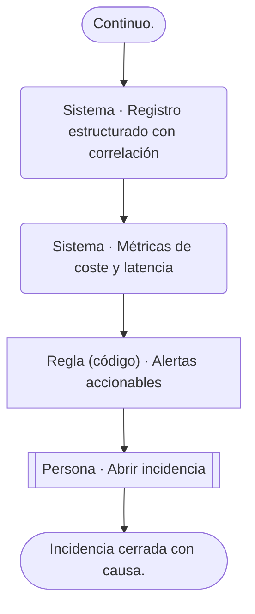

<!-- Generado por tools/org_gen.py desde tools/org_data/. No editar a mano. -->
# P15 · Observabilidad e incidencias

**Origen:** Guía de Arranque v1.4 (Anexo I y II) · **Cuándo implantar:** MVP · **Estado de la ficha:** draft · **Implementado:** No

Leyenda: rectángulo, regla en código · paralelogramo, la IA propone · doble barra, persona · redondeado, sistema.

## 1. Descripción y objetivo
Registrar logs, costes, latencia, errores, decisiones, incidentes y acciones correctivas.

## 2. Evento de inicio
Continuo.

## 3. Condiciones y datos de entrada
Eventos del sistema.

## 4. Actividades y tareas
1. Registro estructurado con correlación (Sistema)
2. Métricas de coste y latencia (Sistema)
3. Alertas accionables (Regla (código))
4. Abrir incidencia (Persona)

## 5. Responsables
Calidad

## 6. Departamentos y especialistas
- [Especialista en calidad y riesgos](../../knowledge/seguridad-legal/calidad-riesgos.md)
- [Especialista backend](../../knowledge/ingenieria/backend.md)

## 7. Decisiones y reglas
- Nunca volcar datos sensibles en registros.

## 8. Estados y transiciones
Incidencia: abierta → en análisis → resuelta → cerrada

## 9. Entradas y salidas de cada tarea
| Tarea | Tipo | Salida |
|---|---|---|
| Registro estructurado con correlación | Sistema | Logs |
| Métricas de coste y latencia | Sistema | Métricas |
| Alertas accionables | Regla (código) | Alerta |
| Abrir incidencia | Persona | Incidencia |

## 10. Sistemas y conectores
- Logs estructurados
- OpenTelemetry (convenciones GenAI no estables)

## 11. Permisos y controles
Mínimos para la tarea; cliente derivado de la identidad.

## 12. Excepciones y rutas alternativas
Errores según P22; incidentes según P28.

## 13. Aprobaciones humanas
Según la matriz de riesgo (docs/14).

## 14. Timeouts y reintentos
Timeout por tarea; máximo 3 intentos con espera exponencial y aleatoria solo para errores transitorios ([P22](P22-gestion-de-errores-y-reintentos.md))

## 15. Criterio de finalización
Incidencia cerrada con causa.

## 16. Evidencias que se conservan
- Logs con correlation_id

## 17. KPI
- Tiempo de detección
- Alertas sin acción

## 18. Dependencias
- [P28](P28-gestion-de-incidentes.md)
- [P29](P29-gestion-de-costes-y-capacidad.md)

## 19. Precedentes y plantillas
Ninguna todavía.

## 20. Pruebas necesarias
- Un log de prueba con DNI inventado aparece redactado.

---
Especialistas: Especialista en calidad y riesgos, Especialista backend. Definición original: Guía de Arranque v1.4 (Anexo I y II).
