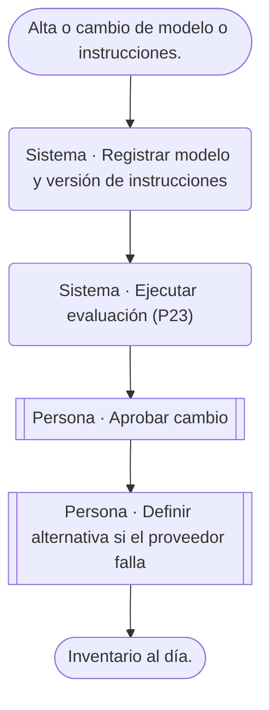

<!-- Generado por tools/org_gen.py desde tools/org_data/. No editar a mano. -->
# P16 · Gobierno de modelos e instrucciones

**Origen:** Guía de Arranque v1.4 (Anexo I y II) · **Cuándo implantar:** Antes de escalar · **Estado de la ficha:** draft · **Implementado:** No

Leyenda: rectángulo, regla en código · paralelogramo, la IA propone · doble barra, persona · redondeado, sistema.

## 1. Descripción y objetivo
Inventariar modelos, versiones, instrucciones, límites, evaluaciones, cambios y alternativas.

## 2. Evento de inicio
Alta o cambio de modelo o instrucciones.

## 3. Condiciones y datos de entrada
Modelo, versión, instrucciones.

## 4. Actividades y tareas
1. Registrar modelo y versión de instrucciones (Sistema)
2. Ejecutar evaluación (P23) (Sistema)
3. Aprobar cambio (Persona)
4. Definir alternativa si el proveedor falla (Persona)

## 5. Responsables
Datos e IA

## 6. Departamentos y especialistas
- [Arquitecto de datos e IA](../../knowledge/ingenieria/datos-ia.md)
- [Especialista en evaluación de IA](../../knowledge/ingenieria/evaluacion-ia.md)

## 7. Decisiones y reglas
- Sin evaluación superada no hay cambio.

## 8. Estados y transiciones
Capacidad: draft → tested → approved → deprecated

## 9. Entradas y salidas de cada tarea
| Tarea | Tipo | Salida |
|---|---|---|
| Registrar modelo y versión de instrucciones | Sistema | Inventario |
| Ejecutar evaluación (P23) | Sistema | Resultados |
| Aprobar cambio | Persona | Cambio aprobado |
| Definir alternativa si el proveedor falla | Persona | Fallback |

## 10. Sistemas y conectores
Motor de procesos y PostgreSQL (por defecto).

## 11. Permisos y controles
Mínimos para la tarea; cliente derivado de la identidad.

## 12. Excepciones y rutas alternativas
Errores según P22; incidentes según P28.

## 13. Aprobaciones humanas
- Socios

## 14. Timeouts y reintentos
Timeout por tarea; máximo 3 intentos con espera exponencial y aleatoria solo para errores transitorios ([P22](P22-gestion-de-errores-y-reintentos.md))

## 15. Criterio de finalización
Inventario al día.

## 16. Evidencias que se conservan
- Evaluación por versión

## 17. KPI
- Regresiones por cambio

## 18. Dependencias
- [P23](P23-evaluacion-de-agentes-y-modelos.md)
- [P25](P25-gestion-de-cambios-y-versiones.md)
- [P27](P27-gestion-de-proveedores-y-dependencias.md)

## 19. Precedentes y plantillas
Ninguna todavía.

## 20. Pruebas necesarias
- Cambio de instrucciones sin evaluación: bloqueado.

---
Especialistas: Arquitecto de datos e IA, Especialista en evaluación de IA. Definición original: Guía de Arranque v1.4 (Anexo I y II).
