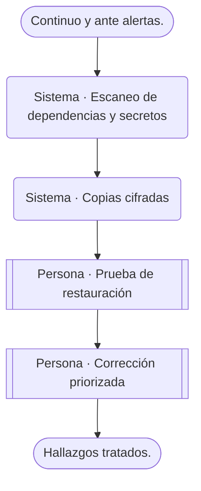

<!-- Generado por tools/org_gen.py desde tools/org_data/. No editar a mano. -->
# P17 · Seguridad y continuidad

**Origen:** Guía de Arranque v1.4 (Anexo I y II) · **Cuándo implantar:** Antes de datos reales · **Estado de la ficha:** draft · **Implementado:** No

Leyenda: rectángulo, regla en código · paralelogramo, la IA propone · doble barra, persona · redondeado, sistema.

## 1. Descripción y objetivo
Gestionar secretos, copias, restauración, vulnerabilidades, dependencias y respuesta a incidentes.

## 2. Evento de inicio
Continuo y ante alertas.

## 3. Condiciones y datos de entrada
Inventario de activos.

## 4. Actividades y tareas
1. Escaneo de dependencias y secretos (Sistema)
2. Copias cifradas (Sistema)
3. Prueba de restauración (Persona)
4. Corrección priorizada (Persona)

## 5. Responsables
Ciberseguridad

## 6. Departamentos y especialistas
- [Especialista en ciberseguridad](../../knowledge/seguridad-legal/ciberseguridad.md)

## 7. Decisiones y reglas
- Copia no probada no es recuperable.

## 8. Estados y transiciones
Hallazgo: abierto → aceptado o corregido → cerrado

## 9. Entradas y salidas de cada tarea
| Tarea | Tipo | Salida |
|---|---|---|
| Escaneo de dependencias y secretos | Sistema | Hallazgos |
| Copias cifradas | Sistema | Copia |
| Prueba de restauración | Persona | Informe |
| Corrección priorizada | Persona | Acciones |

## 10. Sistemas y conectores
Motor de procesos y PostgreSQL (por defecto).

## 11. Permisos y controles
Mínimos para la tarea; cliente derivado de la identidad.

## 12. Excepciones y rutas alternativas
Errores según P22; incidentes según P28.

## 13. Aprobaciones humanas
- Aceptación de riesgo: socios

## 14. Timeouts y reintentos
Timeout por tarea; máximo 3 intentos con espera exponencial y aleatoria solo para errores transitorios ([P22](P22-gestion-de-errores-y-reintentos.md))

## 15. Criterio de finalización
Hallazgos tratados.

## 16. Evidencias que se conservan
- Informe de restauración

## 17. KPI
- Hallazgos críticos abiertos
- Última restauración probada

## 18. Dependencias
- [P26](P26-continuidad-y-recuperacion.md)
- [P28](P28-gestion-de-incidentes.md)
- [P30](P30-gestion-de-identidades-y-secretos.md)

## 19. Precedentes y plantillas
Ninguna todavía.

## 20. Pruebas necesarias
- Restaurar en un entorno limpio y comprobar integridad.

---
Especialistas: Especialista en ciberseguridad. Definición original: Guía de Arranque v1.4 (Anexo I y II).
