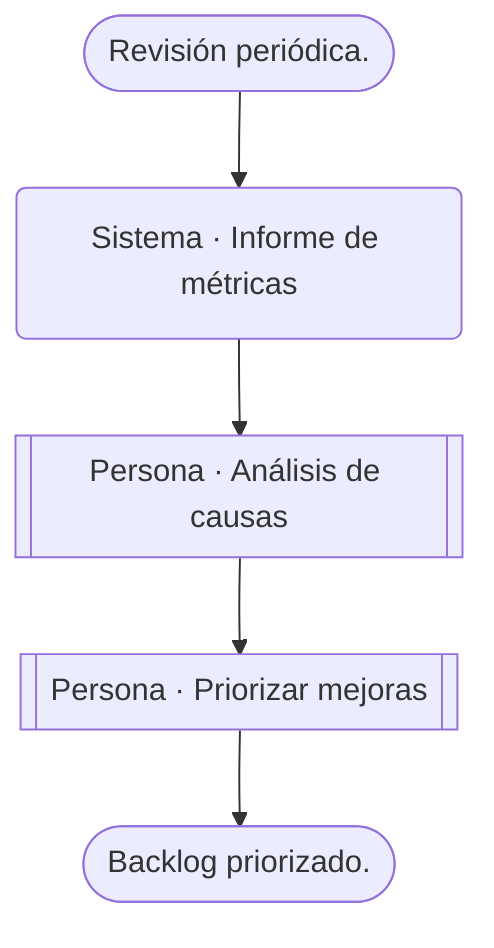

<!-- Generado por tools/org_gen.py desde tools/org_data/. No editar a mano. -->
# P18 · Evaluación y mejora

**Origen:** Guía de Arranque v1.4 (Anexo I y II) · **Cuándo implantar:** Antes de escalar · **Estado de la ficha:** draft · **Implementado:** No

Leyenda: rectángulo, regla en código · paralelogramo, la IA propone · doble barra, persona · redondeado, sistema.

## 1. Descripción y objetivo
Medir calidad, tiempo, coste, retrabajo, errores y satisfacción; priorizar mejoras con evidencia.

## 2. Evento de inicio
Revisión periódica.

## 3. Condiciones y datos de entrada
Métricas de [P15](P15-observabilidad-e-incidencias.md) y [P37](P37-medicion-de-rendimiento-y-valor.md).

## 4. Actividades y tareas
1. Informe de métricas (Sistema)
2. Análisis de causas (Persona)
3. Priorizar mejoras (Persona)

## 5. Responsables
Métricas

## 6. Departamentos y especialistas
- [Especialista en métricas](../../knowledge/procesos/metricas.md)
- [Responsable de decisiones y seguimiento](../../knowledge/direccion/decisiones-seguimiento.md)

## 7. Decisiones y reglas
- Mejora sin métrica de antes y después no se da por hecha.

## 8. Estados y transiciones
Mejora: propuesta → priorizada → hecha → medida

## 9. Entradas y salidas de cada tarea
| Tarea | Tipo | Salida |
|---|---|---|
| Informe de métricas | Sistema | Informe |
| Análisis de causas | Persona | Causas |
| Priorizar mejoras | Persona | Backlog |

## 10. Sistemas y conectores
Motor de procesos y PostgreSQL (por defecto).

## 11. Permisos y controles
Mínimos para la tarea; cliente derivado de la identidad.

## 12. Excepciones y rutas alternativas
Errores según P22; incidentes según P28.

## 13. Aprobaciones humanas
Según la matriz de riesgo (docs/14).

## 14. Timeouts y reintentos
Timeout por tarea; máximo 3 intentos con espera exponencial y aleatoria solo para errores transitorios ([P22](P22-gestion-de-errores-y-reintentos.md))

## 15. Criterio de finalización
Backlog priorizado.

## 16. Evidencias que se conservan
- Informe

## 17. KPI
- Mejoras medidas / hechas

## 18. Dependencias
- [P15](P15-observabilidad-e-incidencias.md)
- [P37](P37-medicion-de-rendimiento-y-valor.md)

## 19. Precedentes y plantillas
Ninguna todavía.

## 20. Pruebas necesarias
- Informe reproducible desde los datos.

---
Especialistas: Especialista en métricas, Responsable de decisiones y seguimiento. Definición original: Guía de Arranque v1.4 (Anexo I y II).
