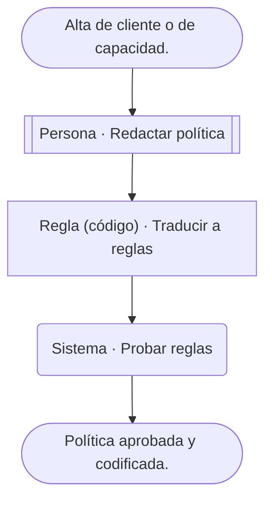

<!-- Generado por tools/org_gen.py desde tools/org_data/. No editar a mano. -->
# P19 · Política de uso y límites

**Origen:** Guía de Arranque v1.4 (Anexo I y II) · **Cuándo implantar:** Antes de automatizar · **Estado de la ficha:** draft · **Implementado:** No

Leyenda: rectángulo, regla en código · paralelogramo, la IA propone · doble barra, persona · redondeado, sistema.

## 1. Descripción y objetivo
Definir tareas permitidas, prohibidas y condicionadas, límites de autonomía y criterios de escalado.

## 2. Evento de inicio
Alta de cliente o de capacidad.

## 3. Condiciones y datos de entrada
Matriz de riesgo, contrato.

## 4. Actividades y tareas
1. Redactar política (Persona)
2. Traducir a reglas (Regla (código))
3. Probar reglas (Sistema)

## 5. Responsables
Legal y Calidad

## 6. Departamentos y especialistas
- [Especialista legal y privacidad](../../knowledge/seguridad-legal/legal-privacidad.md)
- [Especialista en calidad y riesgos](../../knowledge/seguridad-legal/calidad-riesgos.md)

## 7. Decisiones y reglas
- No etiquetar riesgo por el nombre del departamento.

## 8. Estados y transiciones
Política: draft → approved → deprecated

## 9. Entradas y salidas de cada tarea
| Tarea | Tipo | Salida |
|---|---|---|
| Redactar política | Persona | Política |
| Traducir a reglas | Regla (código) | Reglas versionadas |
| Probar reglas | Sistema | Pruebas |

## 10. Sistemas y conectores
Motor de procesos y PostgreSQL (por defecto).

## 11. Permisos y controles
Mínimos para la tarea; cliente derivado de la identidad.

## 12. Excepciones y rutas alternativas
Errores según P22; incidentes según P28.

## 13. Aprobaciones humanas
- Socios y cliente

## 14. Timeouts y reintentos
Timeout por tarea; máximo 3 intentos con espera exponencial y aleatoria solo para errores transitorios ([P22](P22-gestion-de-errores-y-reintentos.md))

## 15. Criterio de finalización
Política aprobada y codificada.

## 16. Evidencias que se conservan
- Política y pruebas

## 17. KPI
- Encargos bloqueados por política

## 18. Dependencias
- [P02](P02-clasificacion-y-triaje.md)

## 19. Precedentes y plantillas
Ninguna todavía.

## 20. Pruebas necesarias
- Acción prohibida se bloquea en todas las vías.

---
Especialistas: Especialista legal y privacidad, Especialista en calidad y riesgos. Definición original: Guía de Arranque v1.4 (Anexo I y II).
