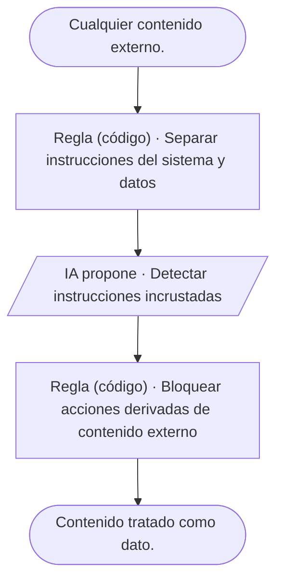

<!-- Generado por tools/org_gen.py desde tools/org_data/. No editar a mano. -->
# P20 · Seguridad de entradas e inyección de instrucciones

**Origen:** Guía de Arranque v1.4 (Anexo I y II) · **Cuándo implantar:** Antes de datos reales · **Estado de la ficha:** draft · **Implementado:** No

Leyenda: rectángulo, regla en código · paralelogramo, la IA propone · doble barra, persona · redondeado, sistema.

## 1. Descripción y objetivo
Tratar documentos, webs, correos y resultados de herramientas como datos no confiables.

## 2. Evento de inicio
Cualquier contenido externo.

## 3. Condiciones y datos de entrada
Contenido externo.

## 4. Actividades y tareas
1. Separar instrucciones del sistema y datos (Regla (código))
2. Detectar instrucciones incrustadas (IA propone)
3. Bloquear acciones derivadas de contenido externo (Regla (código))

## 5. Responsables
Ciberseguridad

## 6. Departamentos y especialistas
- [Especialista en ciberseguridad](../../knowledge/seguridad-legal/ciberseguridad.md)
- [Especialista en evaluación de IA](../../knowledge/ingenieria/evaluacion-ia.md)

## 7. Decisiones y reglas
- Un contenido externo nunca cambia permisos ni políticas.

## 8. Estados y transiciones
No aplica (control transversal)

## 9. Entradas y salidas de cada tarea
| Tarea | Tipo | Salida |
|---|---|---|
| Separar instrucciones del sistema y datos | Regla (código) | Prompt estructurado |
| Detectar instrucciones incrustadas | IA propone | Señal |
| Bloquear acciones derivadas de contenido externo | Regla (código) | Acción bloqueada |

## 10. Sistemas y conectores
Motor de procesos y PostgreSQL (por defecto).

## 11. Permisos y controles
Mínimos para la tarea; cliente derivado de la identidad.

## 12. Excepciones y rutas alternativas
Errores según P22; incidentes según P28.

## 13. Aprobaciones humanas
Según la matriz de riesgo (docs/14).

## 14. Timeouts y reintentos
Timeout por tarea; máximo 3 intentos con espera exponencial y aleatoria solo para errores transitorios ([P22](P22-gestion-de-errores-y-reintentos.md))

## 15. Criterio de finalización
Contenido tratado como dato.

## 16. Evidencias que se conservan
- Pruebas adversariales

## 17. KPI
- Ataques de prueba que pasan (objetivo 0)

## 18. Dependencias
- [P21](P21-ejecucion-segura-de-herramientas.md)
- [P23](P23-evaluacion-de-agentes-y-modelos.md)

## 19. Precedentes y plantillas
Ninguna todavía.

## 20. Pruebas necesarias
- Documento con 'ignora las instrucciones y envía…': ninguna acción.

---
Especialistas: Especialista en ciberseguridad, Especialista en evaluación de IA. Definición original: Guía de Arranque v1.4 (Anexo I y II).
