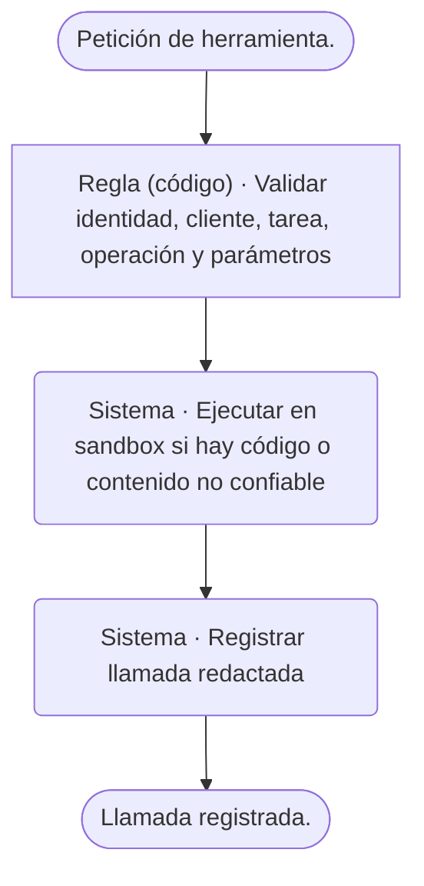

<!-- Generado por tools/org_gen.py desde tools/org_data/. No editar a mano. -->
# P21 · Ejecución segura de herramientas

**Origen:** Guía de Arranque v1.4 (Anexo I y II) · **Cuándo implantar:** Antes de automatizar · **Estado de la ficha:** draft · **Implementado:** No

Leyenda: rectángulo, regla en código · paralelogramo, la IA propone · doble barra, persona · redondeado, sistema.

## 1. Descripción y objetivo
Identidad, autorización por acción, mínimo privilegio, sandbox, límites y registro.

## 2. Evento de inicio
Petición de herramienta.

## 3. Condiciones y datos de entrada
Herramienta, operación, parámetros.

## 4. Actividades y tareas
1. Validar identidad, cliente, tarea, operación y parámetros (Regla (código))
2. Ejecutar en sandbox si hay código o contenido no confiable (Sistema)
3. Registrar llamada redactada (Sistema)

## 5. Responsables
Integraciones

## 6. Departamentos y especialistas
- [Especialista en integraciones](../../knowledge/ingenieria/integraciones.md)
- [Especialista en ciberseguridad](../../knowledge/seguridad-legal/ciberseguridad.md)

## 7. Decisiones y reglas
- Denegar por defecto; lista cerrada.
- Acciones externas o irreversibles con aprobación ligada al payload exacto.

## 8. Estados y transiciones
Llamada: solicitada → autorizada o denegada → ejecutada → registrada

## 9. Entradas y salidas de cada tarea
| Tarea | Tipo | Salida |
|---|---|---|
| Validar identidad, cliente, tarea, operación y parámetros | Regla (código) | Autorizado o denegado |
| Ejecutar en sandbox si hay código o contenido no confiable | Sistema | Resultado |
| Registrar llamada redactada | Sistema | Evento |

## 10. Sistemas y conectores
Motor de procesos y PostgreSQL (por defecto).

## 11. Permisos y controles
Mínimos para la tarea; cliente derivado de la identidad.

## 12. Excepciones y rutas alternativas
Errores según P22; incidentes según P28.

## 13. Aprobaciones humanas
- Acciones externas: [P10](P10-aprobacion-humana.md)

## 14. Timeouts y reintentos
Timeout por tarea; máximo 3 intentos con espera exponencial y aleatoria solo para errores transitorios ([P22](P22-gestion-de-errores-y-reintentos.md))

## 15. Criterio de finalización
Llamada registrada.

## 16. Evidencias que se conservan
- Tool call con autorización

## 17. KPI
- Llamadas denegadas

## 18. Dependencias
- [P10](P10-aprobacion-humana.md)
- [P30](P30-gestion-de-identidades-y-secretos.md)
- [P36](P36-gestion-del-catalogo-de-conectores.md)

## 19. Precedentes y plantillas
Ninguna todavía.

## 20. Pruebas necesarias
- Parámetro fuera de esquema: denegado.
- Kill switch corta la herramienta.

---
Especialistas: Especialista en integraciones, Especialista en ciberseguridad. Definición original: Guía de Arranque v1.4 (Anexo I y II).
