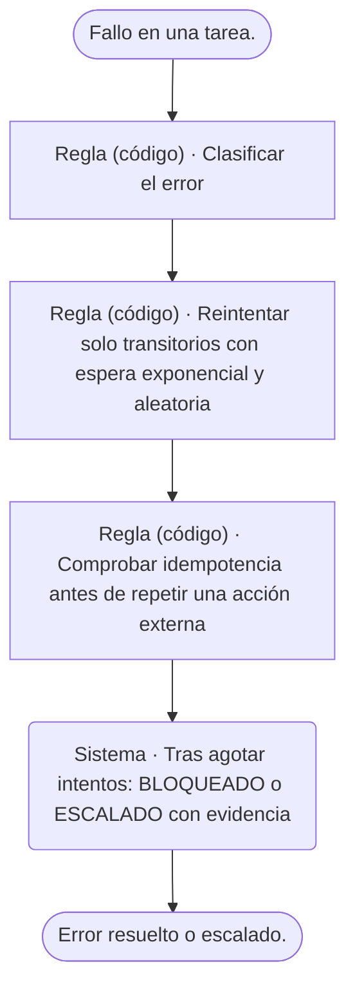

<!-- Generado por tools/org_gen.py desde tools/org_data/. No editar a mano. -->
# P22 · Gestión de errores y reintentos

**Origen:** Guía de Arranque v1.4 (Anexo I y II) · **Cuándo implantar:** Antes de automatizar · **Estado de la ficha:** draft · **Implementado:** Sí: src/varios/procesos/reintentos.py con pruebas

Leyenda: rectángulo, regla en código · paralelogramo, la IA propone · doble barra, persona · redondeado, sistema.

## 1. Descripción y objetivo
Clasificar errores, limitar reintentos, evitar duplicados, aplicar timeout, alternativa, bloqueo y escalado.

## 2. Evento de inicio
Fallo en una tarea.

## 3. Condiciones y datos de entrada
Error.

## 4. Actividades y tareas
1. Clasificar el error (Regla (código))
2. Reintentar solo transitorios con espera exponencial y aleatoria (Regla (código))
3. Comprobar idempotencia antes de repetir una acción externa (Regla (código))
4. Tras agotar intentos: BLOQUEADO o ESCALADO con evidencia (Sistema)

## 5. Responsables
Backend

## 6. Departamentos y especialistas
- [Especialista backend](../../knowledge/ingenieria/backend.md)
- [Especialista en automatización](../../knowledge/procesos/automatizacion.md)

## 7. Decisiones y reglas
- No reintentar errores de permisos, seguridad ni políticas.
- No reintentar indefinidamente.

## 8. Estados y transiciones
Tarea: running → failed / blocked

## 9. Entradas y salidas de cada tarea
| Tarea | Tipo | Salida |
|---|---|---|
| Clasificar el error | Regla (código) | Tipo |
| Reintentar solo transitorios con espera exponencial y aleatoria | Regla (código) | Reintento o no |
| Comprobar idempotencia antes de repetir una acción externa | Regla (código) | Resultado previo o nueva ejecución |
| Tras agotar intentos: BLOQUEADO o ESCALADO con evidencia | Sistema | Estado y alternativa manual |

## 10. Sistemas y conectores
Motor de procesos y PostgreSQL (por defecto).

## 11. Permisos y controles
Mínimos para la tarea; cliente derivado de la identidad.

## 12. Excepciones y rutas alternativas
Errores según P22; incidentes según P28.

## 13. Aprobaciones humanas
Según la matriz de riesgo (docs/14).

## 14. Timeouts y reintentos
Timeout por tarea; máximo 3 intentos con espera exponencial y aleatoria solo para errores transitorios ([P22](P22-gestion-de-errores-y-reintentos.md))

## 15. Criterio de finalización
Error resuelto o escalado.

## 16. Evidencias que se conservan
- Intentos y causas

## 17. KPI
- Reintentos por éxito
- Duplicados evitados

## 18. Dependencias
- [P08](P08-ejecucion-de-tareas.md)
- [P28](P28-gestion-de-incidentes.md)

## 19. Precedentes y plantillas
Ninguna todavía.

## 20. Pruebas necesarias
- Clave de idempotencia repetida devuelve el resultado anterior sin ejecutar.
- Error de autorización: un solo intento.

---
Especialistas: Especialista backend, Especialista en automatización. Definición original: Guía de Arranque v1.4 (Anexo I y II).
