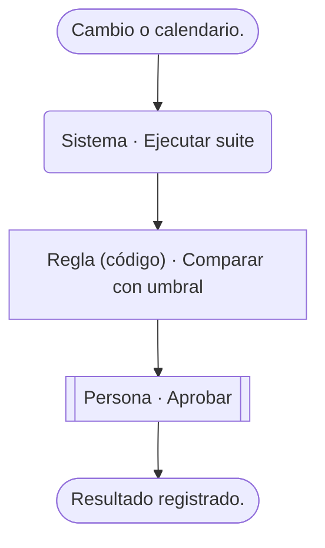

<!-- Generado por tools/org_gen.py desde tools/org_data/. No editar a mano. -->
# P23 · Evaluación de agentes y modelos

**Origen:** Guía de Arranque v1.4 (Anexo I y II) · **Cuándo implantar:** Antes de escalar · **Estado de la ficha:** draft · **Implementado:** No

Leyenda: rectángulo, regla en código · paralelogramo, la IA propone · doble barra, persona · redondeado, sistema.

## 1. Descripción y objetivo
Casos de prueba representativos, umbrales de calidad, regresión y aprobación de cambios.

## 2. Evento de inicio
Cambio o calendario.

## 3. Condiciones y datos de entrada
Dataset versionado.

## 4. Actividades y tareas
1. Ejecutar suite (Sistema)
2. Comparar con umbral (Regla (código))
3. Aprobar (Persona)

## 5. Responsables
Evaluación de IA

## 6. Departamentos y especialistas
- [Especialista en evaluación de IA](../../knowledge/ingenieria/evaluacion-ia.md)

## 7. Decisiones y reglas
- Umbral por caso de uso y riesgo (pendiente: 22/01/2027).

## 8. Estados y transiciones
Evaluación: preparada → ejecutada → aprobada / rechazada

## 9. Entradas y salidas de cada tarea
| Tarea | Tipo | Salida |
|---|---|---|
| Ejecutar suite | Sistema | Resultados por campo |
| Comparar con umbral | Regla (código) | Pasa o no |
| Aprobar | Persona | Decisión |

## 10. Sistemas y conectores
Motor de procesos y PostgreSQL (por defecto).

## 11. Permisos y controles
Mínimos para la tarea; cliente derivado de la identidad.

## 12. Excepciones y rutas alternativas
Errores según P22; incidentes según P28.

## 13. Aprobaciones humanas
- Socios

## 14. Timeouts y reintentos
Timeout por tarea; máximo 3 intentos con espera exponencial y aleatoria solo para errores transitorios ([P22](P22-gestion-de-errores-y-reintentos.md))

## 15. Criterio de finalización
Resultado registrado.

## 16. Evidencias que se conservan
- Informe por versión

## 17. KPI
- Exactitud
- Alucinación factual

## 18. Dependencias
- [P16](P16-gobierno-de-modelos-e-instrucciones.md)
- [P25](P25-gestion-de-cambios-y-versiones.md)

## 19. Precedentes y plantillas
Ninguna todavía.

## 20. Pruebas necesarias
- Dataset con casos límite y adversariales.

---
Especialistas: Especialista en evaluación de IA. Definición original: Guía de Arranque v1.4 (Anexo I y II).
