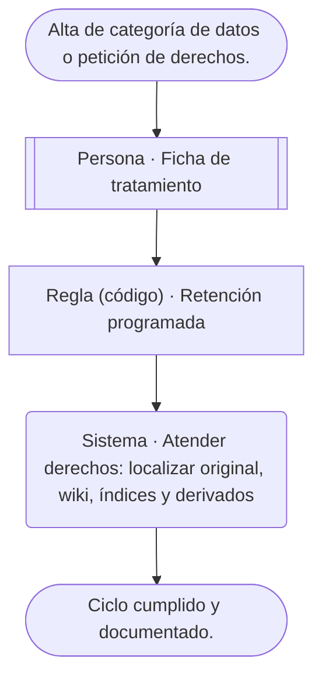

<!-- Generado por tools/org_gen.py desde tools/org_data/. No editar a mano. -->
# P24 · Gestión del ciclo de vida del dato

**Origen:** Guía de Arranque v1.4 (Anexo I y II) · **Cuándo implantar:** Antes de datos reales · **Estado de la ficha:** draft · **Implementado:** No

Leyenda: rectángulo, regla en código · paralelogramo, la IA propone · doble barra, persona · redondeado, sistema.

## 1. Descripción y objetivo
Finalidad, clasificación, retención, acceso, exportación, rectificación y borrado, incluidos copias y derivados.

## 2. Evento de inicio
Alta de categoría de datos o petición de derechos.

## 3. Condiciones y datos de entrada
Ficha de tratamiento.

## 4. Actividades y tareas
1. Ficha de tratamiento (Persona)
2. Retención programada (Regla (código))
3. Atender derechos: localizar original, wiki, índices y derivados (Sistema)

## 5. Responsables
Legal y privacidad

## 6. Departamentos y especialistas
- [Especialista legal y privacidad](../../knowledge/seguridad-legal/legal-privacidad.md)
- [Especialista backend](../../knowledge/ingenieria/backend.md)

## 7. Decisiones y reglas
- No conservar indefinidamente por comodidad.

## 8. Estados y transiciones
Dato: alta → uso → conservación → borrado

## 9. Entradas y salidas de cada tarea
| Tarea | Tipo | Salida |
|---|---|---|
| Ficha de tratamiento | Persona | Ficha |
| Retención programada | Regla (código) | Borrado o bloqueo |
| Atender derechos: localizar original, wiki, índices y derivados | Sistema | Respuesta |

## 10. Sistemas y conectores
Motor de procesos y PostgreSQL (por defecto).

## 11. Permisos y controles
Mínimos para la tarea; cliente derivado de la identidad.

## 12. Excepciones y rutas alternativas
Errores según P22; incidentes según P28.

## 13. Aprobaciones humanas
- Retención legal: Legal

## 14. Timeouts y reintentos
Timeout por tarea; máximo 3 intentos con espera exponencial y aleatoria solo para errores transitorios ([P22](P22-gestion-de-errores-y-reintentos.md))

## 15. Criterio de finalización
Ciclo cumplido y documentado.

## 16. Evidencias que se conservan
- Registro de borrados

## 17. KPI
- Peticiones de derechos en plazo

## 18. Dependencias
- [P07](P07-ingesta-documental.md)
- [P14](P14-gestion-de-permisos-y-aislamiento.md)

## 19. Precedentes y plantillas
Ninguna todavía.

## 20. Pruebas necesarias
- Borrado alcanza índices y derivados.

---
Especialistas: Especialista legal y privacidad, Especialista backend. Definición original: Guía de Arranque v1.4 (Anexo I y II).
