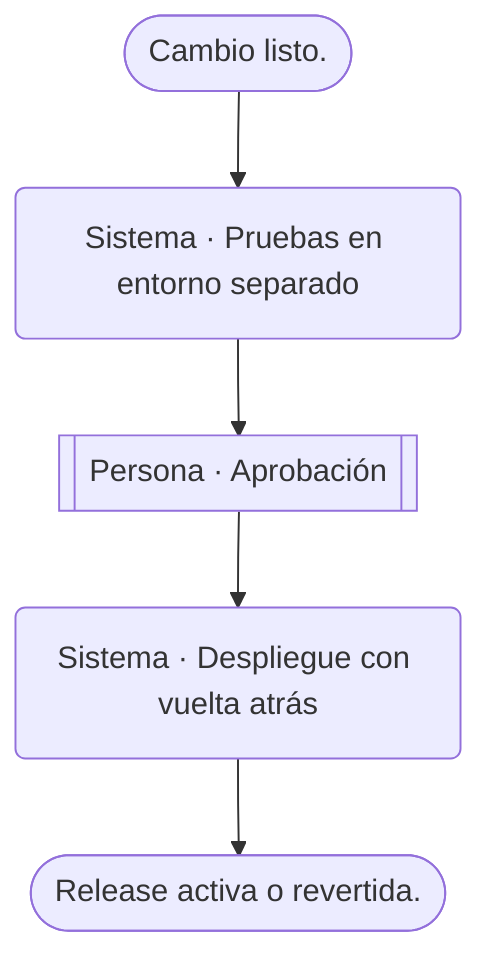

<!-- Generado por tools/org_gen.py desde tools/org_data/. No editar a mano. -->
# P25 · Gestión de cambios y versiones

**Origen:** Guía de Arranque v1.4 (Anexo I y II) · **Cuándo implantar:** Antes de escalar · **Estado de la ficha:** draft · **Implementado:** No

Leyenda: rectángulo, regla en código · paralelogramo, la IA propone · doble barra, persona · redondeado, sistema.

## 1. Descripción y objetivo
Versionar instrucciones, modelos, reglas, herramientas y código; probar aparte; aprobar y poder revertir.

## 2. Evento de inicio
Cambio listo.

## 3. Condiciones y datos de entrada
Artefactos versionados.

## 4. Actividades y tareas
1. Pruebas en entorno separado (Sistema)
2. Aprobación (Persona)
3. Despliegue con vuelta atrás (Sistema)

## 5. Responsables
Arquitecto técnico

## 6. Departamentos y especialistas
- [Arquitecto técnico](../../knowledge/ingenieria/arquitecto-tecnico.md)

## 7. Decisiones y reglas
- Toda release tiene vuelta atrás probada.

## 8. Estados y transiciones
Release: candidata → aprobada → desplegada → revertida

## 9. Entradas y salidas de cada tarea
| Tarea | Tipo | Salida |
|---|---|---|
| Pruebas en entorno separado | Sistema | Resultados |
| Aprobación | Persona | Release aprobada |
| Despliegue con vuelta atrás | Sistema | Release activa |

## 10. Sistemas y conectores
Motor de procesos y PostgreSQL (por defecto).

## 11. Permisos y controles
Mínimos para la tarea; cliente derivado de la identidad.

## 12. Excepciones y rutas alternativas
Errores según P22; incidentes según P28.

## 13. Aprobaciones humanas
- Socios

## 14. Timeouts y reintentos
Timeout por tarea; máximo 3 intentos con espera exponencial y aleatoria solo para errores transitorios ([P22](P22-gestion-de-errores-y-reintentos.md))

## 15. Criterio de finalización
Release activa o revertida.

## 16. Evidencias que se conservan
- Release con versiones y prueba

## 17. KPI
- Reversiones

## 18. Dependencias
- [P12](P12-gestion-de-cambios.md)
- [P23](P23-evaluacion-de-agentes-y-modelos.md)

## 19. Precedentes y plantillas
Ninguna todavía.

## 20. Pruebas necesarias
- Revertir y comprobar estado.

---
Especialistas: Arquitecto técnico. Definición original: Guía de Arranque v1.4 (Anexo I y II).
