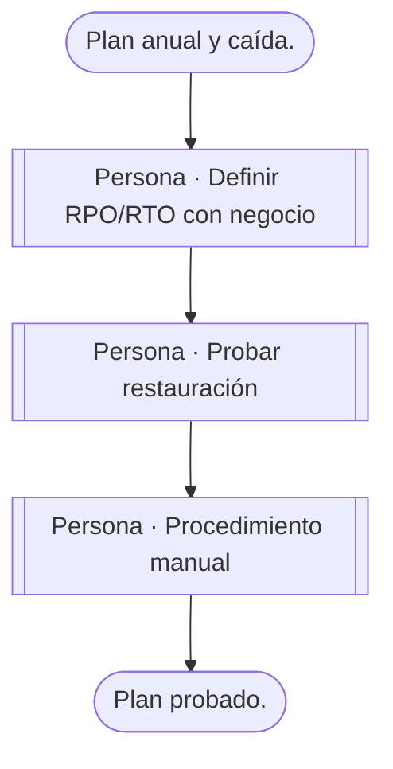

<!-- Generado por tools/org_gen.py desde tools/org_data/. No editar a mano. -->
# P26 · Continuidad y recuperación

**Origen:** Guía de Arranque v1.4 (Anexo I y II) · **Cuándo implantar:** Antes de escalar · **Estado de la ficha:** draft · **Implementado:** No

Leyenda: rectángulo, regla en código · paralelogramo, la IA propone · doble barra, persona · redondeado, sistema.

## 1. Descripción y objetivo
RPO/RTO por criticidad, copias cifradas, restauraciones reales y procedimiento manual alternativo.

## 2. Evento de inicio
Plan anual y caída.

## 3. Condiciones y datos de entrada
Servicios y criticidad.

## 4. Actividades y tareas
1. Definir RPO/RTO con negocio (Persona)
2. Probar restauración (Persona)
3. Procedimiento manual (Persona)

## 5. Responsables
Ciberseguridad

## 6. Departamentos y especialistas
- [Especialista en ciberseguridad](../../knowledge/seguridad-legal/ciberseguridad.md)

## 7. Decisiones y reglas
- No inventar un RTO universal.

## 8. Estados y transiciones
Plan: borrador → probado → vigente

## 9. Entradas y salidas de cada tarea
| Tarea | Tipo | Salida |
|---|---|---|
| Definir RPO/RTO con negocio | Persona | Objetivos |
| Probar restauración | Persona | Informe |
| Procedimiento manual | Persona | Runbook |

## 10. Sistemas y conectores
Motor de procesos y PostgreSQL (por defecto).

## 11. Permisos y controles
Mínimos para la tarea; cliente derivado de la identidad.

## 12. Excepciones y rutas alternativas
Errores según P22; incidentes según P28.

## 13. Aprobaciones humanas
Según la matriz de riesgo (docs/14).

## 14. Timeouts y reintentos
Timeout por tarea; máximo 3 intentos con espera exponencial y aleatoria solo para errores transitorios ([P22](P22-gestion-de-errores-y-reintentos.md))

## 15. Criterio de finalización
Plan probado.

## 16. Evidencias que se conservan
- Pruebas de restauración

## 17. KPI
- Tiempo real de restauración

## 18. Dependencias
- [P17](P17-seguridad-y-continuidad.md)

## 19. Precedentes y plantillas
- processes/runbooks/restauracion.md

## 20. Pruebas necesarias
- Simulacro de caída del proveedor de LLM.

---
Especialistas: Especialista en ciberseguridad. Definición original: Guía de Arranque v1.4 (Anexo I y II).
