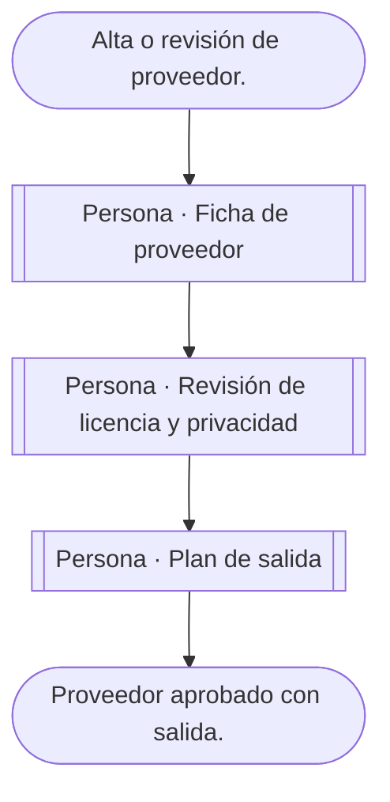

<!-- Generado por tools/org_gen.py desde tools/org_data/. No editar a mano. -->
# P27 · Gestión de proveedores y dependencias

**Origen:** Guía de Arranque v1.4 (Anexo I y II) · **Cuándo implantar:** Antes de datos reales · **Estado de la ficha:** draft · **Implementado:** No

Leyenda: rectángulo, regla en código · paralelogramo, la IA propone · doble barra, persona · redondeado, sistema.

## 1. Descripción y objetivo
Inventariar LLM, API, librerías y terceros; privacidad, ubicación, condiciones, disponibilidad, cambios y salida.

## 2. Evento de inicio
Alta o revisión de proveedor.

## 3. Condiciones y datos de entrada
Condiciones del proveedor.

## 4. Actividades y tareas
1. Ficha de proveedor (Persona)
2. Revisión de licencia y privacidad (Persona)
3. Plan de salida (Persona)

## 5. Responsables
Costes y proveedores

## 6. Departamentos y especialistas
- [Especialista en costes y proveedores](../../knowledge/administracion-finanzas/costes-proveedores.md)
- [Especialista legal y privacidad](../../knowledge/seguridad-legal/legal-privacidad.md)

## 7. Decisiones y reglas
- Licencias no OSI se revisan antes de usarlas en servicios a clientes.

## 8. Estados y transiciones
Proveedor: propuesto → aprobado → en revisión → retirado

## 9. Entradas y salidas de cada tarea
| Tarea | Tipo | Salida |
|---|---|---|
| Ficha de proveedor | Persona | Ficha |
| Revisión de licencia y privacidad | Persona | Apto o no |
| Plan de salida | Persona | Plan |

## 10. Sistemas y conectores
Motor de procesos y PostgreSQL (por defecto).

## 11. Permisos y controles
Mínimos para la tarea; cliente derivado de la identidad.

## 12. Excepciones y rutas alternativas
Errores según P22; incidentes según P28.

## 13. Aprobaciones humanas
- Socios

## 14. Timeouts y reintentos
Timeout por tarea; máximo 3 intentos con espera exponencial y aleatoria solo para errores transitorios ([P22](P22-gestion-de-errores-y-reintentos.md))

## 15. Criterio de finalización
Proveedor aprobado con salida.

## 16. Evidencias que se conservan
- Ficha

## 17. KPI
- Proveedores sin ficha (objetivo 0)

## 18. Dependencias
- [P16](P16-gobierno-de-modelos-e-instrucciones.md)
- [P29](P29-gestion-de-costes-y-capacidad.md)

## 19. Precedentes y plantillas
- knowledge/plantillas/ficha-proveedor.md

## 20. Pruebas necesarias
- Cambio de condiciones detectado en la revisión.

---
Especialistas: Especialista en costes y proveedores, Especialista legal y privacidad. Definición original: Guía de Arranque v1.4 (Anexo I y II).
