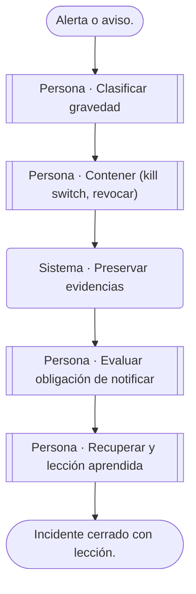

<!-- Generado por tools/org_gen.py desde tools/org_data/. No editar a mano. -->
# P28 · Gestión de incidentes

**Origen:** Guía de Arranque v1.4 (Anexo I y II) · **Cuándo implantar:** Antes de escalar · **Estado de la ficha:** draft · **Implementado:** No

Leyenda: rectángulo, regla en código · paralelogramo, la IA propone · doble barra, persona · redondeado, sistema.

## 1. Descripción y objetivo
Detectar, clasificar, contener, preservar evidencias, notificar, recuperar y aprender.

## 2. Evento de inicio
Alerta o aviso.

## 3. Condiciones y datos de entrada
Indicios.

## 4. Actividades y tareas
1. Clasificar gravedad (Persona)
2. Contener (kill switch, revocar) (Persona)
3. Preservar evidencias (Sistema)
4. Evaluar obligación de notificar (Persona)
5. Recuperar y lección aprendida (Persona)

## 5. Responsables
Ciberseguridad y Calidad

## 6. Departamentos y especialistas
- [Especialista en ciberseguridad](../../knowledge/seguridad-legal/ciberseguridad.md)
- [Especialista en calidad y riesgos](../../knowledge/seguridad-legal/calidad-riesgos.md)
- [Especialista legal y privacidad](../../knowledge/seguridad-legal/legal-privacidad.md)

## 7. Decisiones y reglas
- Brecha de datos personales con riesgo: 72 horas a la AEPD (Marco legal).

## 8. Estados y transiciones
Incidente: detectado → contenido → erradicado → recuperado → cerrado

## 9. Entradas y salidas de cada tarea
| Tarea | Tipo | Salida |
|---|---|---|
| Clasificar gravedad | Persona | Gravedad |
| Contener (kill switch, revocar) | Persona | Contención |
| Preservar evidencias | Sistema | Evidencias |
| Evaluar obligación de notificar | Persona | Decisión |
| Recuperar y lección aprendida | Persona | Precedente |

## 10. Sistemas y conectores
Motor de procesos y PostgreSQL (por defecto).

## 11. Permisos y controles
Mínimos para la tarea; cliente derivado de la identidad.

## 12. Excepciones y rutas alternativas
Errores según P22; incidentes según P28.

## 13. Aprobaciones humanas
- Notificaciones: socios con asesoría

## 14. Timeouts y reintentos
Timeout por tarea; máximo 3 intentos con espera exponencial y aleatoria solo para errores transitorios ([P22](P22-gestion-de-errores-y-reintentos.md))

## 15. Criterio de finalización
Incidente cerrado con lección.

## 16. Evidencias que se conservan
- Cronología

## 17. KPI
- Tiempo de contención

## 18. Dependencias
- [P15](P15-observabilidad-e-incidencias.md)
- [P17](P17-seguridad-y-continuidad.md)
- [P13](P13-aprendizaje-y-actualizacion-de-la-wiki.md)

## 19. Precedentes y plantillas
- processes/runbooks/
- precedents/plantilla-incidente.md

## 20. Pruebas necesarias
- Simulacro de fuga sospechada.

---
Especialistas: Especialista en ciberseguridad, Especialista en calidad y riesgos, Especialista legal y privacidad. Definición original: Guía de Arranque v1.4 (Anexo I y II).
