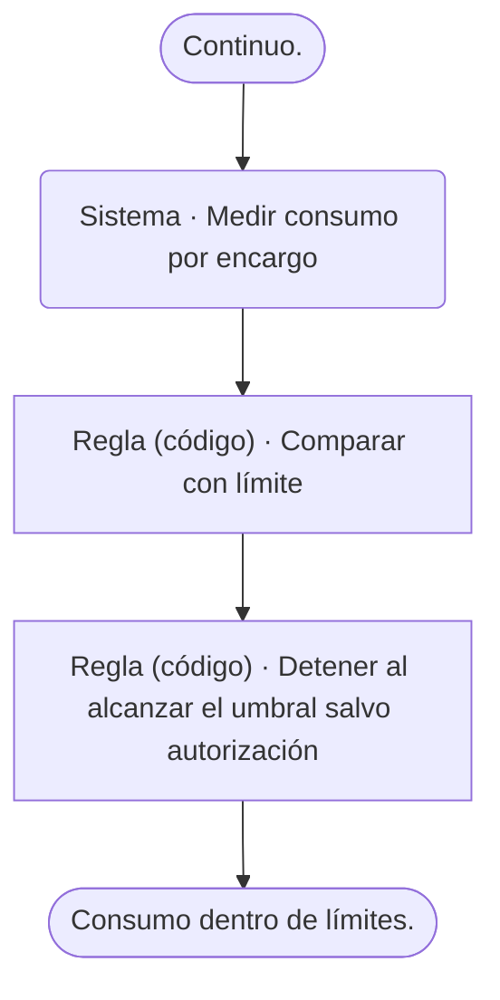

<!-- Generado por tools/org_gen.py desde tools/org_data/. No editar a mano. -->
# P29 · Gestión de costes y capacidad

**Origen:** Guía de Arranque v1.4 (Anexo I y II) · **Cuándo implantar:** Antes de automatizar · **Estado de la ficha:** draft · **Implementado:** No

Leyenda: rectángulo, regla en código · paralelogramo, la IA propone · doble barra, persona · redondeado, sistema.

## 1. Descripción y objetivo
Presupuestos por proyecto y cliente, límites de tokens y llamadas, alertas, cuotas y concurrencia.

## 2. Evento de inicio
Continuo.

## 3. Condiciones y datos de entrada
Consumo.

## 4. Actividades y tareas
1. Medir consumo por encargo (Sistema)
2. Comparar con límite (Regla (código))
3. Detener al alcanzar el umbral salvo autorización (Regla (código))

## 5. Responsables
Costes

## 6. Departamentos y especialistas
- [Especialista en costes y proveedores](../../knowledge/administracion-finanzas/costes-proveedores.md)
- [Especialista en métricas](../../knowledge/procesos/metricas.md)

## 7. Decisiones y reglas
- Al llegar al límite se para, no se avisa solo.

## 8. Estados y transiciones
Presupuesto: abierto → alerta → agotado

## 9. Entradas y salidas de cada tarea
| Tarea | Tipo | Salida |
|---|---|---|
| Medir consumo por encargo | Sistema | Coste |
| Comparar con límite | Regla (código) | Dentro o fuera |
| Detener al alcanzar el umbral salvo autorización | Regla (código) | Pausa |

## 10. Sistemas y conectores
Motor de procesos y PostgreSQL (por defecto).

## 11. Permisos y controles
Mínimos para la tarea; cliente derivado de la identidad.

## 12. Excepciones y rutas alternativas
Errores según P22; incidentes según P28.

## 13. Aprobaciones humanas
- Ampliar presupuesto: socio

## 14. Timeouts y reintentos
Timeout por tarea; máximo 3 intentos con espera exponencial y aleatoria solo para errores transitorios ([P22](P22-gestion-de-errores-y-reintentos.md))

## 15. Criterio de finalización
Consumo dentro de límites.

## 16. Evidencias que se conservan
- Coste por encargo

## 17. KPI
- Coste por caso

## 18. Dependencias
- [P06](P06-asignacion-y-coordinacion.md)
- [P15](P15-observabilidad-e-incidencias.md)

## 19. Precedentes y plantillas
Ninguna todavía.

## 20. Pruebas necesarias
- Encargo que supera el límite queda en pausa.

---
Especialistas: Especialista en costes y proveedores, Especialista en métricas. Definición original: Guía de Arranque v1.4 (Anexo I y II).
