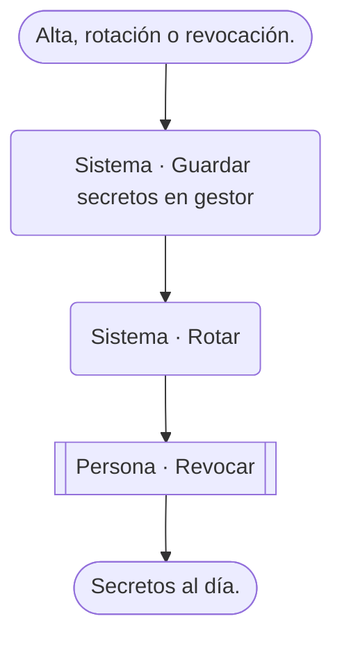

<!-- Generado por tools/org_gen.py desde tools/org_data/. No editar a mano. -->
# P30 · Gestión de identidades y secretos

**Origen:** Guía de Arranque v1.4 (Anexo I y II) · **Cuándo implantar:** Antes de datos reales · **Estado de la ficha:** draft · **Implementado:** No

Leyenda: rectángulo, regla en código · paralelogramo, la IA propone · doble barra, persona · redondeado, sistema.

## 1. Descripción y objetivo
Autenticación, autorización, roles, rotación y almacenamiento seguro de secretos.

## 2. Evento de inicio
Alta, rotación o revocación.

## 3. Condiciones y datos de entrada
Identidades y secretos.

## 4. Actividades y tareas
1. Guardar secretos en gestor (Sistema)
2. Rotar (Sistema)
3. Revocar (Persona)

## 5. Responsables
Ciberseguridad

## 6. Departamentos y especialistas
- [Especialista en ciberseguridad](../../knowledge/seguridad-legal/ciberseguridad.md)
- [Especialista en integraciones](../../knowledge/ingenieria/integraciones.md)

## 7. Decisiones y reglas
- Prohibido incluir credenciales en instrucciones, registros o repositorios.

## 8. Estados y transiciones
Secreto: activo → rotado → revocado

## 9. Entradas y salidas de cada tarea
| Tarea | Tipo | Salida |
|---|---|---|
| Guardar secretos en gestor | Sistema | Secreto |
| Rotar | Sistema | Secreto nuevo |
| Revocar | Persona | Revocado |

## 10. Sistemas y conectores
- Gestor de secretos (decisión pendiente)

## 11. Permisos y controles
Mínimos para la tarea; cliente derivado de la identidad.

## 12. Excepciones y rutas alternativas
Errores según P22; incidentes según P28.

## 13. Aprobaciones humanas
Según la matriz de riesgo (docs/14).

## 14. Timeouts y reintentos
Timeout por tarea; máximo 3 intentos con espera exponencial y aleatoria solo para errores transitorios ([P22](P22-gestion-de-errores-y-reintentos.md))

## 15. Criterio de finalización
Secretos al día.

## 16. Evidencias que se conservan
- Registro de rotaciones

## 17. KPI
- Secretos sin rotar

## 18. Dependencias
- [P14](P14-gestion-de-permisos-y-aislamiento.md)
- [P21](P21-ejecucion-segura-de-herramientas.md)

## 19. Precedentes y plantillas
Ninguna todavía.

## 20. Pruebas necesarias
- Escáner de secretos en cada propuesta de cambios.

---
Especialistas: Especialista en ciberseguridad, Especialista en integraciones. Definición original: Guía de Arranque v1.4 (Anexo I y II).
