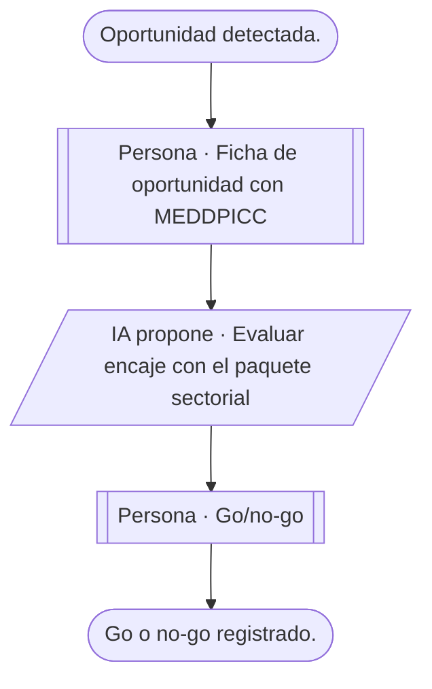

<!-- Generado por tools/org_gen.py desde tools/org_data/. No editar a mano. -->
# P31 · Calificación de oportunidad

**Origen:** Atlas Evolución v1.1 §10 (propuesta) · **Cuándo implantar:** MVP · **Estado de la ficha:** draft · **Implementado:** No

Leyenda: rectángulo, regla en código · paralelogramo, la IA propone · doble barra, persona · redondeado, sistema.

## 1. Descripción y objetivo
Problema, sponsor, encaje, impacto, viabilidad, riesgo y go/no-go.

## 2. Evento de inicio
Oportunidad detectada.

## 3. Condiciones y datos de entrada
Datos de la empresa y del problema.

## 4. Actividades y tareas
1. Ficha de oportunidad con MEDDPICC (Persona)
2. Evaluar encaje con el paquete sectorial (IA propone)
3. Go/no-go (Persona)

## 5. Responsables
Director comercial

## 6. Departamentos y especialistas
- [Director comercial](../../knowledge/comercial/director-comercial.md)
- [Especialista en prospección](../../knowledge/comercial/prospeccion.md)

## 7. Decisiones y reglas
- Sin problema material ni sponsor confirmado no hay G0.

## 8. Estados y transiciones
Despliegue: qualified (si go)

## 9. Entradas y salidas de cada tarea
| Tarea | Tipo | Salida |
|---|---|---|
| Ficha de oportunidad con MEDDPICC | Persona | Ficha |
| Evaluar encaje con el paquete sectorial | IA propone | Encaje propuesto |
| Go/no-go | Persona | Decisión |

## 10. Sistemas y conectores
Motor de procesos y PostgreSQL (por defecto).

## 11. Permisos y controles
Mínimos para la tarea; cliente derivado de la identidad.

## 12. Excepciones y rutas alternativas
Errores según P22; incidentes según P28.

## 13. Aprobaciones humanas
- Socios

## 14. Timeouts y reintentos
Timeout por tarea; máximo 3 intentos con espera exponencial y aleatoria solo para errores transitorios ([P22](P22-gestion-de-errores-y-reintentos.md))

## 15. Criterio de finalización
Go o no-go registrado.

## 16. Evidencias que se conservan
- Ficha

## 17. KPI
- Oportunidades que pasan G0

## 18. Dependencias
- [P38](P38-gestion-de-despliegue-por-cliente.md)

## 19. Precedentes y plantillas
- knowledge/plantillas/ficha-oportunidad.md

## 20. Pruebas necesarias
- Ficha sin comprador económico: no-go.

---
Especialistas: Director comercial, Especialista en prospección. Definición original: Atlas Evolución v1.1 §10 (propuesta).
